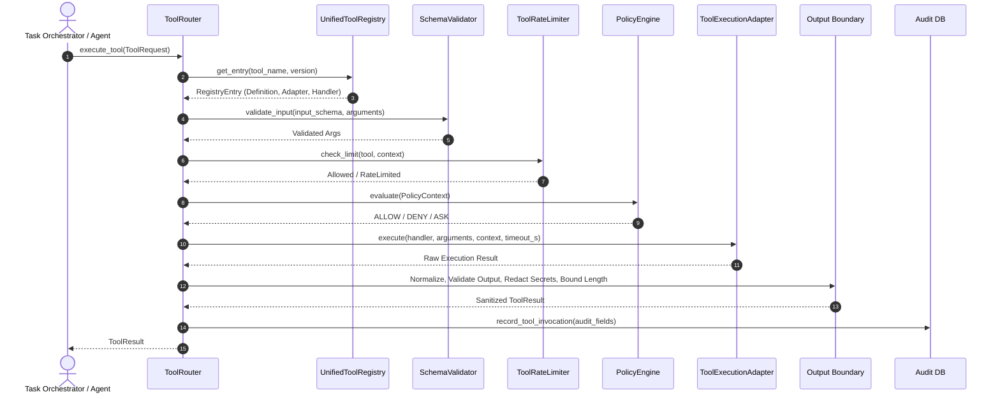

# 06 — Tool Execution Pipeline & Adapters

## 1. Overview

The Tool Execution Pipeline provides a unified, deterministic, and safe execution path for all tool invocations. It eliminates signature-guessing vulnerabilities, enforces strict per-tool timeouts, and processes handler outputs through a standardized sanitization boundary.

---

## 2. Pipeline Sequence

Every request follows an immutable, 9-stage pipeline:



---

## 3. ToolExecutionAdapter Protocol

All execution adapters implement the `ToolExecutionAdapter` protocol defined in [`backend/agent/tools/adapters/base.py`](file:///Users/meetvirugama/Desktop/AI-Powered-Software-Development-Platform/backend/agent/tools/adapters/base.py):

```python
class ToolExecutionAdapter(Protocol):
    async def execute(
        self,
        handler: Callable[..., Any],
        arguments: Dict[str, Any],
        context: Optional[Dict[str, Any]] = None,
        timeout_s: Optional[float] = None,
    ) -> Any: ...
```

### 3.1 `BuiltinWorkspaceAdapter`
- Bridges registered workspace tools with `WorkspaceToolPolicyBridge`.
- Inspects handler signatures ahead of time (`inspect.signature`) to determine whether `context` or `workspace_id` parameters are accepted.
- Passes arguments directly matching the handler's declared signature.

### 3.2 `MCPToolAdapter` & `PluginToolAdapter` Boundaries
- Clean interfaces for remote or out-of-process tool adapters (Model Context Protocol via stdio/SSE and platform marketplace plugins).
- Encapsulate transport serialization, connection lifecycle, and external error mapping.

---

## 4. Zero-Retry Guarantee (Elimination of `TypeError` Guessing)

### Vulnerability in Legacy Routers
Legacy systems often executed handlers with `handler(**arguments)`, caught `TypeError`, and re-executed with `handler(arguments)`. If a handler failed internally with a legitimate `TypeError` (e.g., attempting `x + None`), the legacy router caught it, assumed the calling signature was wrong, and **executed the handler a second time**.

> [!CAUTION]
> If the handler had already executed a non-idempotent action (such as writing a file, debiting a balance, or spawning a process), retrying it causes duplicate mutations and system corruption.

### Safe Modern Approach
`BuiltinWorkspaceAdapter` inspects the function parameters using Python's `inspect.signature` **before execution**:
- It binds arguments according to the inspect signature once.
- Once the handler is called, any internal `TypeError` is treated as a normal execution failure and is **never** retried.

---

## 5. Per-Tool Timeout Enforcement

Every tool specifies a default or custom `timeout_s` in its `ToolDefinition`.

```python
try:
    raw_result = await asyncio.wait_for(adapter.execute(...), timeout=timeout_s)
except asyncio.TimeoutError:
    return ToolResult(
        success=False,
        error=f"Tool '{name}' execution timed out after {timeout_s}s",
        error_category="TIMEOUT_ERROR",
        timed_out=True,
    )
```

- When execution exceeds `timeout_s`, the task is cancelled cleanly.
- `ToolResult.timed_out` is set to `True`.
- The database record classifies the status as `ToolInvocationStatus.TIMEOUT`.

---

## 6. Output Boundary: Sanitization & Bounding

Regardless of adapter or tool source, raw outputs pass through a shared output pipeline:

1. **Normalization:** Scalars, strings, dictionaries, and exceptions are normalized into a dictionary structure.
2. **Output Schema Validation:** If the tool registers an `output_schema`, fields are verified against Draft 2020-12 constraints.
3. **Secret Redaction:** High-entropy tokens, API keys, passwords, and authorization headers are scrubbed using regular expression patterns.
4. **Length Bounding:** Oversized outputs exceeding maximum thresholds (e.g., 50,000 characters) are truncated with an informative notice to prevent downstream LLM context overflow.
