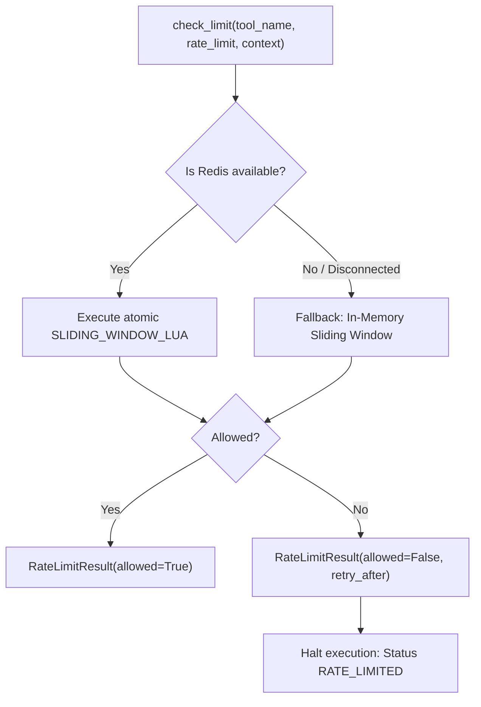

# 07 — Security, Permissions & Policy Enforcement

## 1. Overview

Tool execution security follows a zero-trust model. Agents or clients can propose tool calls, but they cannot dictate tool metadata, risk classifications, timeouts, or policy exemptions. Every invocation is vetted by input validation, rate limiting, and policy evaluation before reaching an adapter.

---

## 2. Zero-Trust Security Principles

### 2.1 Complete Distrust of Client Metadata
Clients may specify `tool_name` and `arguments`. However, the execution pipeline retrieves all authorization controls—such as `risk_tier`, `rate_limit`, `timeout_s`, and `annotations`—directly from the server-side `UnifiedToolRegistry`. Any attempt by an LLM or client request to override risk tiers or bypass allowlists is ignored.

### 2.2 Fail-Closed Authorization
- If a tool is missing from the registry, execution fails closed (`NOT_FOUND`).
- If the policy engine or rate limiter experiences an unexpected error, execution fails closed (`SECURITY_BLOCKED`).
- If a policy decision evaluates to anything other than `Decision.ALLOW`, handler execution is blocked.

---

## 3. PolicyEngine Integration

Before a tool is executed, `ToolRouter` evaluates `PolicyContext` via `PolicyEngine`:

```python
policy_context = PolicyContext(
    action=tool_name,
    resource=arguments.get("path") or arguments.get("command") or tool_name,
    user_id=context.get("user_id"),
    workspace_id=context.get("workspace_id"),
    risk_tier=definition.risk_tier.value,
    metadata=arguments,
)
decision = await policy_engine.evaluate(policy_context)
```

- **`Decision.ALLOW`**: Proceed to rate limiting and adapter execution.
- **`Decision.DENY`**: Return `ToolResult(success=False, error="Tool execution denied by policy", error_category="SECURITY_BLOCKED")`. Handler is never called.
- **`Decision.ASK`**: Requires manual human-in-the-loop approval. Execution is halted.

---

## 4. Command Security & Shell Injection Defense

For execution tools (e.g., `run_command`), strict defense-in-depth measures prevent shell injection, privilege escalation, and lateral movement:

### 4.1 Argv Tokenization & Shell Metacharacter Blocking
- Tools must receive commands as structured token lists (`argv: List[str]`) rather than raw shell strings.
- Raw shell strings with unescaped shell metacharacters (`;`, `&`, `|`, `>`, `<`, `$`, `` ` ``, `\n`) are rejected immediately.

### 4.2 Dangerous Flag Filtering
Commands must not invoke flags that allow arbitrary code execution or unvetted scripts:
- Prohibited flags: `-c`, `--command`, `--exec`, `--upload-pack`, `--override-ini`, etc.

### 4.3 Path Traversal Prevention
Arguments pointing to filesystem paths are strictly validated:
- Rejects `..`, `../`, `..\\`, absolute root references escaping the workspace directory, and symlinks pointing outside the sandbox root.

---

## 5. Multi-Tier Sliding-Window Rate Limiting

Implemented in [`backend/agent/tools/rate_limiter.py`](file:///Users/meetvirugama/Desktop/AI-Powered-Software-Development-Platform/backend/agent/tools/rate_limiter.py), the `ToolRateLimiter` enforces atomic sliding-window quotas to protect infrastructure from runaway agent loops.



### 5.1 Atomic Redis Lua Script
```lua
local key = KEYS[1]
local now = tonumber(ARGV[1])
local window = tonumber(ARGV[2])
local max_requests = tonumber(ARGV[3])
local clear_before = now - window

redis.call('ZREMRANGEBYSCORE', key, 0, clear_before)
local current_requests = redis.call('ZCARD', key)
if current_requests < max_requests then
    redis.call('ZADD', key, now, now)
    redis.call('EXPIRE', key, math.ceil(window))
    return {1, max_requests - current_requests - 1, 0}
else
    local oldest = redis.call('ZRANGE', key, 0, 0, 'WITHSCORES')
    local retry_after = 0
    if oldest and #oldest >= 2 then
        retry_after = math.max(0, math.ceil(tonumber(oldest[2]) + window - now))
    end
    return {0, 0, retry_after}
end
```

### 5.2 Scoping Strategy
Quotas can be partitioned across different scopes:
- **`task`**: Limits invocations per task run (prevents infinite tool loops).
- **`user`**: Limits invocations across a single user session.
- **`provider`**: Limits invocations hitting expensive external third-party APIs.
- **`global`**: System-wide protection ceiling.
