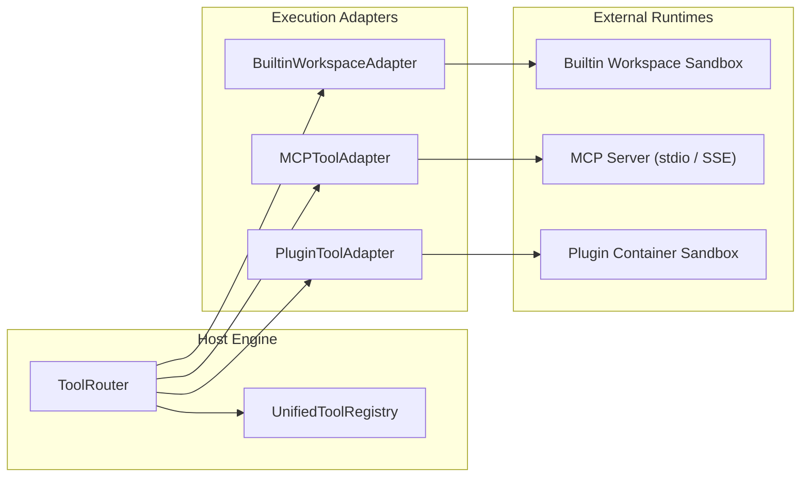

# 11 — Future MCP & Plugin Integration

## 1. Overview

The Unified Tool Registry was specifically designed to support the upcoming integration of the Model Context Protocol (MCP) and third-party marketplace plugins without requiring architectural rewrites.

---

## 2. Model Context Protocol (MCP) Adapter Design

The `MCPToolAdapter` (boundary interface in [`backend/agent/tools/adapters/mcp.py`](file:///Users/meetvirugama/Desktop/AI-Powered-Software-Development-Platform/backend/agent/tools/adapters/mcp.py)) establishes standard communication with MCP servers.

### 2.1 Supported Transports
1. **`stdio`**: Communicates with subprocesses over standard input/output streams using JSON-RPC 2.0.
2. **`sse` (Server-Sent Events)**: Communicates with remote HTTP endpoints over streaming HTTP/SSE.

### 2.2 Discovery and Registration Flow
1. **Handshake:** MCP client establishes connection and exchanges capabilities (`initialize`).
2. **Catalog Fetch:** Invokes `tools/list` to retrieve tool schemas.
3. **Registry Ingestion:** Each tool is transformed into a `ToolDefinition` with:
   - `source = ToolSource.MCP`
   - `provider_id = mcp_server_id`
   - `name = f"{provider_id}__{remote_tool_name}"` (namespace protection)
   - `input_schema` validated against Draft 2020-12
4. **Invocation:** Requests are mapped to JSON-RPC `tools/call`.

---

## 3. Marketplace Plugins & Sandboxing

The `PluginToolAdapter` handles plugins packaged from the Antigravity Agent Marketplace.

### 3.1 Namespace Isolation
To ensure third-party plugins cannot intercept or shadow canonical tools:
- The registry explicitly blocks `ToolSource.PLUGIN` and `ToolSource.MCP` from claiming protected names (e.g., `view_file`, `edit_file`, `run_command`).
- Plugin tools are automatically namespaced by their package bundle ID.

### 3.2 Permission Scopes
Each plugin declares required permissions in its manifest:
- `network:outbound` (allowed hostnames)
- `filesystem:read` (workspace scope only)
- `filesystem:write` (workspace scope only)
- `secrets:read` (specific environment key references)

These scopes map directly to the platform's `PolicyEngine`, which enforces containment at the tool router boundary.
