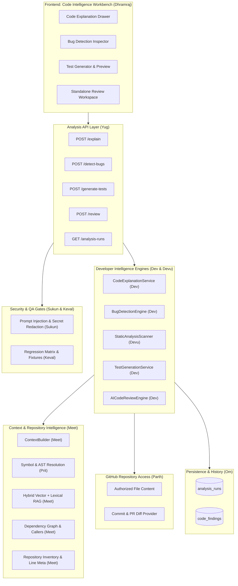
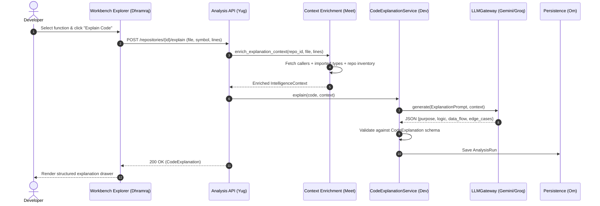

# Week 2 — Developer Intelligence Suite

**Project:** AI-Powered Software Development Platform  
**Duration:** 7 working days  
**Team:** Meet, Dev, Dhramraj, Yug, Om, Parth, Prit, Sukun, Keval, Devu  
**Prerequisite:** Week 1 Foundation (GitHub App, Scanner, Chunker, Hybrid RAG, Grounding, Workbench UI)

---

## 1. Week 2 Executive Summary & Architecture

Week 2 builds four independent, production-grade **developer-intelligence features** on top of the Week 1 foundation:

1. **Code Explanation:** Explain a selected file, function, class, or code line range with architectural context and dependency graphs.
2. **Bug Detection:** Identify potential correctness, security, and reliability defects by harmonizing deterministic static analysis with grounded AI reasoning.
3. **Test Generation:** Generate framework-aware, repository-convention-compatible unit tests with comprehensive assertions and edge cases.
4. **AI Code Review:** Review files, commits, and GitHub pull-request diffs without autonomous execution, combining lint findings and AI recommendations.

> [!IMPORTANT]
> **Week 2 is NOT the autonomous-agent week.**  
> Week 2 establishes the developer-intelligence engines, context pipelines, structured schemas, and persistence layer that Week 3's autonomous task planner, Docker sandbox execution, and Draft PR automation will consume.



---

## 2. Approved AI Providers Policy

As established in `Docs/team_rules.md` and enforced by Week 1 security gates:
- **Approved Providers:** **Google Gemini** (`gemini-flash-lite-latest`, `gemini-1.5-pro`) and **Groq** (`llama-3.3-70b-versatile`).
- **Forbidden:** No OpenAI, Anthropic, or unapproved external LLM endpoints in production code paths.
- **Provider Redundancy:** Automatic failover between Gemini and Groq via `LLMGateway`.
- **System/Data Separation:** Repository source code, diffs, and comments are treated as untrusted data (`<<<REPO_DATA_...>>>`), never injected into system instructions.

---

## 3. Team Ownership Matrix

| Member | Primary Ownership | Core Deliverables |
|---|---|---|
| **Meet** | **Repository Context & Intelligence Integration** | Context enrichment for Explanation, Bug Detection, Tests, and Review; AST symbol, caller, and dependency resolution; token budgeting. |
| **Dev** | **AI Analysis Engines & Prompts** | `CodeExplanationService`, `BugDetectionEngine`, `TestGenerationService`, `AICodeReviewEngine`, validated Pydantic schemas. |
| **Dhramraj** | **Developer Intelligence UI** | Workbench Explorer drawers, Bug Inspector, Test Preview/Download modal, Review Diff viewer. |
| **Yug** | **Analysis API & Orchestration** | REST routes (`/explain`, `/detect-bugs`, `/generate-tests`, `/review`, `/analysis-runs`), validation, authorization. |
| **Om** | **Persistence & History Schema** | `analysis_runs` and `code_findings` models, Alembic migrations, historical queries. |
| **Parth** | **GitHub Repository Data Integration** | Authorized file contents, commit metadata, and PR diff retrieval using GitHub App tokens. |
| **Prit** | **AST & Framework Intelligence** | Function/class boundary extraction, line-range mapping, test framework detection (`pytest`, `unittest`, `jest`). |
| **Sukun** | **Security & Guardrails** | Prompt injection defenses, credential redaction, authorization boundaries, safe error handling. |
| **Keval** | **QA, Acceptance & Regression** | Multi-language defect fixtures, integration test suite, false-positive metrics. |
| **Devu** | **Static Analysis & Findings Normalization** | Ruff/ESLint/Bandit adapters, secret scanning, static + AI finding deduplication and ranking. |

---

## 4. Day-by-Day Implementation Roadmap

### DAY 1 — Foundation, Schemas & API Contracts

**Goal:** Freeze shared Pydantic schemas, register API route definitions, establish persistence models, and connect the Workbench Explorer.

#### Meet — Repository Context Integration
- Audit existing `backend/ai/context/builder.py` and `backend/ai/pipeline.py`.
- Define the shared `IntelligenceContext` interface for all 4 features:
  - Target code snippet with exact `file_path`, `start_line`, and `end_line`.
  - Immediate caller functions and enclosing class/module.
  - Imported symbols, types, and external dependencies.
  - Relevant documentation, types, and related repository files.
- Enforce token budgets (maximum 10,000 tokens for context per analysis).

#### Dev — Output Schemas & Validation
- Implement typed Pydantic models in `backend/ai/schemas/analysis.py`:
  - `CodeExplanation` (purpose, logic_steps, key_symbols, data_flow, dependencies, edge_cases).
  - `BugFinding` (category, severity, description, file_path, line_range, evidence, suggested_fix, source, confidence).
  - `TestGenerationResult` (framework, proposed_path, test_content, covered_scenarios, assumptions).
  - `ReviewReport` & `ReviewFinding` (summary, findings, risk_level, diff_stats).

#### Dhramraj — Repository Explorer Foundation
- Enhance `/repositories/:id` Code Intelligence Workbench.
- Wire up interactive action triggers: **"Explain Code"**, **"Detect Bugs"**, **"Generate Tests"**, and **"Code Review"**.
- Ensure split file tree, line numbers, and symbol selections pass valid parameters to analysis drawers.

#### Yug — Analysis API Foundation
- Create `backend/app/api/v1/analysis.py` with FastAPI router:
  - `POST /api/v1/repositories/{id}/explain`
  - `POST /api/v1/repositories/{id}/detect-bugs`
  - `POST /api/v1/repositories/{id}/generate-tests`
  - `POST /api/v1/repositories/{id}/review`
  - `GET /api/v1/repositories/{id}/analysis-runs`
  - `GET /api/v1/analysis-runs/{run_id}`
- Enforce `_owned_repository` authentication and tenant isolation.

#### Om — Persistence Architecture
- Create database models in `backend/app/models/analysis_run.py` and `code_finding.py`:
  - `AnalysisRun`: `id`, `repository_id`, `user_id`, `feature_type`, `target_path`, `target_revision`, `status`, `summary`, `created_at`.
  - `CodeFinding`: `id`, `run_id`, `category`, `severity`, `file_path`, `start_line`, `end_line`, `message`, `evidence`, `remediation`, `source_type`.
- Write Alembic migration script.

#### Parth — GitHub Repository Access
- Implement `GitHubService.get_file_content(installation_id, owner, repo, path, ref)`.
- Support commit metadata and raw patch/diff retrieval.

#### Prit — AST Extraction & Range Resolution
- Connect `SymbolExtractor` to map selected function/class names to exact start/end line numbers.
- Provide fallback line ranges for unstructured files.

#### Devu — Static Analysis Foundation
- Configure linter adapters (Ruff for Python, ESLint configuration reader for TS/JS).
- Establish regex-based secret scanning for high-entropy tokens and API keys.

#### Sukun — Security Guardrails
- Define untrusted boundary wrappers (`_fence`) for all source code submitted to intelligence prompts.
- Implement secret scrubbing utility for outputs and log streams.

#### Keval — Baseline QA & Fixtures
- Assemble testing fixtures in `backend/tests/fixtures/intelligence_sample/`:
  - Python files with intentional bugs (off-by-one, None dereference, resource leak).
  - TypeScript files with type bugs and missing test coverage.

---

### DAY 2 — Feature 1: Structured Code Explanation

**Goal:** A developer can select any file, function, or line range and receive an evidence-backed, multi-dimensional code explanation.



- **Deliverable:** Working Code Explanation drawer in the Workbench, supporting both whole-file and selected-symbol queries.

---

### DAY 3 — Feature 2: Dedicated Bug Detection

**Goal:** Scan files or functions for potential correctness, security, and reliability defects with normalized static and AI findings.

- **Dev (`BugDetectionEngine`)**: Implements prompts targeting off-by-one, null safety, resource leaks, unhandled exceptions, and boundary logic errors.
- **Devu (`StaticBugScanner`)**: Executes Ruff/Bandit and secret scanning, returning standardized `BugFinding` structures.
- **Meet (`BugContext`)**: Retrieves surrounding call-sites and error handling blocks to reduce false-positive rates.
- **Yug (`POST /detect-bugs`)**: Merges, deduplicates, and ranks static and AI findings by severity.
- **Dhramraj (`Bug Scanner UI`)**: Renders findings filterable by severity (Critical, High, Medium, Low) with in-code line highlights.

---

### DAY 4 — Feature 3: Framework-Aware Test Generation

**Goal:** Generate complete, runnable unit test files adhering to detected repository testing conventions.

- **Prit (`FrameworkDetector`)**: Inspects `pyproject.toml`, `requirements.txt`, `package.json`, and directory trees to detect test runners (`pytest`, `unittest`, `jest`).
- **Meet (`TestContext`)**: Extracts target signatures, dependencies, mocked services, and existing test patterns from `backend/scanner/test_mapper.py`.
- **Dev (`TestGenerationService`)**: Generates complete, non-stubbed test code with positive, negative, and edge-case assertions.
- **Yug (`POST /generate-tests`)**: Returns proposed test file path, complete code content, and scenario descriptions.
- **Dhramraj (`Test Preview UI`)**: Syntax-highlighted code preview with One-Click Copy and Download affordances.

---

### DAY 5 — Feature 4: Standalone AI Code Review

**Goal:** Submit a file, commit SHA, or GitHub PR diff and receive a comprehensive, categorized code review report.

- **Parth (`DiffProvider`)**: Retrieves diffs via GitHub App API, handling oversized diffs, binary files, and renames.
- **Dev (`AICodeReviewEngine`)**: Analyzes changes across 5 dimensions: **Correctness, Security, Performance, Reliability, and Maintainability**.
- **Devu (`StaticReviewer`)**: Runs static lint checks on modified files and merges with AI suggestions.
- **Meet (`MultiFileReviewContext`)**: Provides cross-file dependency impact and caller context for changed functions.
- **Dhramraj (`Review UI`)**: Side-by-side or unified diff viewer with inline review comments and risk level indicator.

---

### DAYS 6–7 — Integration, Security Gates & Release Verification

- **End-to-End Acceptance (Keval)**: Execute the full test matrix across Python and TypeScript repositories.
- **Security Audit (Sukun)**: Validate prompt injection resistance (`<<<REPO_DATA_...>>>` boundary defense) and secret scrubbing.
- **Cross-Feature Optimization (Meet)**: Ensure token-budget enforcement and caching across all 4 intelligence endpoints.
- **Quality Gate**: 100% backend test pass, test coverage >= 70%, 7/7 security checks green, frontend build clean.

---

## 5. Shared API Specifications

```yaml
paths:
  /api/v1/repositories/{id}/explain:
    post:
      summary: Explain a code file, function, or line range
      requestBody:
        content:
          application/json:
            schema:
              type: object
              required: [file_path]
              properties:
                file_path: {type: string}
                symbol_name: {type: string, nullable: true}
                start_line: {type: integer, nullable: true}
                end_line: {type: integer, nullable: true}
      responses:
        200:
          content:
            application/json:
              schema: {$ref: '#/components/schemas/CodeExplanation'}

  /api/v1/repositories/{id}/detect-bugs:
    post:
      summary: Detect potential defects using static analysis and AI
      requestBody:
        content:
          application/json:
            schema:
              type: object
              required: [file_path]
              properties:
                file_path: {type: string}
                start_line: {type: integer, nullable: true}
                end_line: {type: integer, nullable: true}
      responses:
        200:
          content:
            application/json:
              schema:
                type: object
                properties:
                  findings: {type: array, items: {$ref: '#/components/schemas/BugFinding'}}
                  scan_summary: {type: object}

  /api/v1/repositories/{id}/generate-tests:
    post:
      summary: Generate framework-aware test suite for code
      requestBody:
        content:
          application/json:
            schema:
              type: object
              required: [file_path]
              properties:
                file_path: {type: string}
                symbol_name: {type: string, nullable: true}
                framework: {type: string, nullable: true}
      responses:
        200:
          content:
            application/json:
              schema: {$ref: '#/components/schemas/TestGenerationResult'}

  /api/v1/repositories/{id}/review:
    post:
      summary: Review a file, commit, or PR diff
      requestBody:
        content:
          application/json:
            schema:
              type: object
              properties:
                file_path: {type: string, nullable: true}
                commit_sha: {type: string, nullable: true}
                pull_request_number: {type: integer, nullable: true}
                raw_diff: {type: string, nullable: true}
      responses:
        200:
          content:
            application/json:
              schema: {$ref: '#/components/schemas/ReviewReport'}

  /api/v1/repositories/{id}/analysis-runs:
    get:
      summary: Retrieve analysis run history for a repository
      responses:
        200:
          content:
            application/json:
              schema:
                type: array
                items: {$ref: '#/components/schemas/AnalysisRunSummary'}
```

---

## 6. Definition of Done & Acceptance Criteria

A feature is complete only when all the following are satisfied:

1. **Working End-to-End**: Real backend API and frontend UI connected; zero mock or placeholder fallbacks on the production path.
2. **Schema Validated**: Every AI response passes strict Pydantic model validation.
3. **Repository Grounded**: Real line numbers, verified file paths, and accurate symbol citations.
4. **Resilient**: Graceful handling of provider timeouts, rate limits, and malformed outputs with self-healing retries.
5. **Multi-Tenant Security**: Zero cross-user data leaks, strict repository ownership enforcement, and prompt injection fences.
6. **Tested**: Comprehensive unit and integration test coverage exceeding the 70% threshold.
7. **Documented**: API contracts and daily task completions tracked in `Docs/`.
