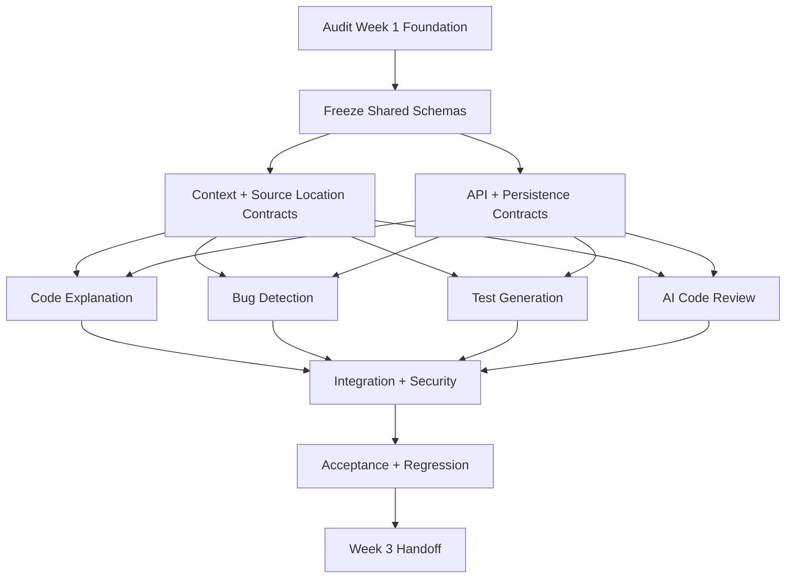

# Week 2 — Developer Intelligence Suite
## Detailed Implementation Plan, Feature Ownership, APIs, Testing and Acceptance Criteria

**Project:** AI-Powered Software Development Platform  
**Duration:** 7 working days  
**Team:** Meet, Dev, Dhramraj, Yug, Om, Parth, Prit, Sukun, Keval, Devu  
**Prerequisite:** Week 1 repository synchronization, source analysis, indexing, RAG and repository-chat capabilities must be audited before dependent work begins.

---

# 1. Week 2 Mission

Week 2 transforms the existing repository-aware platform into a developer-intelligence product.

A developer must be able to open a repository and independently use four features:

1. **Code Explanation** — Understand a file, class, function or selected range using repository context.
2. **Bug Detection** — Identify potential defects using static analysis, AST-based rules and AI-assisted reasoning.
3. **Test Generation** — Generate framework-aware test files that follow the repository's existing conventions.
4. **AI Code Review** — Review a file, commit or supported GitHub pull-request diff without starting an autonomous coding task.

These must be real, independently usable features. They must not be hidden inside repository chat or an autonomous-agent workflow.

## 1.1 What the user should be able to do

```text
User Login
    |
    v
Open Connected Repository
    |
    v
Repository Code Explorer
    |
    +---- Select File / Function
    |          |
    |          +---- Explain Code
    |          |
    |          +---- Find Bugs
    |          |
    |          +---- Generate Tests
    |
    +---- Select File / Commit / PR Diff
               |
               v
         AI Code Review
               |
               v
      Structured Results + Evidence
               |
               v
       Save and Revisit Analysis
```

## 1.2 What is deliberately excluded

Do not implement these as Week 2 deliverables:

- GitHub issue creation.
- Autonomous code modification.
- Task approval and agent execution.
- Automatic test repair.
- Automated branch pushing.
- Pull-request creation.
- Automatic merging or deployment.

Those belong to Week 3. Week 2 should provide the reliable analysis services that Week 3 will reuse.

---

# 2. Existing Project Audit Before Implementation

The project already has a substantial architecture. The first task is to understand its actual implementation and contracts before adding new code.

Inspect the following existing locations in the uploaded project. Verify exact paths and exports against the current checkout before changing anything.

| Existing area | Inspect | Reuse for Week 2 |
|---|---|---|
| `backend/ai/llm/` | Provider interfaces, error handling, retries and response parsing | All four AI features |
| `backend/ai/pipeline.py` | Existing AI pipeline behavior and integration points | Shared AI processing where appropriate |
| `backend/ai/context/builder.py` | Context construction, file selection and source metadata | Explanations, bug detection, tests and review |
| `backend/ai/retrieval/` | Search, ranking and retrieval contracts | Relevant repository context |
| `backend/ai/schemas/` | Existing validation conventions | Feature-specific structured outputs |
| `backend/ai/prompts/` | Existing prompt organization and templates | Feature-specific prompts |
| `backend/scanner/` | File discovery, parsing and existing scanner rules | Static analysis and source selection |
| `backend/indexer/` | Indexing, chunking, symbols and index status | Repository content and symbol lookup |
| `backend/app/api/v1/` | Existing router registration and request/response patterns | Analysis APIs |
| `backend/app/integrations/github/` | GitHub authentication and repository operations | File, commit and PR-diff retrieval |
| `backend/app/models/` | Existing SQLAlchemy models | Analysis history and findings |
| `backend/app/repositories/` | Database access patterns | Analysis persistence |
| `backend/tests/` | Fixtures, mocks and test conventions | Regression and acceptance testing |
| `frontend/src/services/` | API client and authentication handling | All frontend analysis requests |
| `frontend/src/pages/` | Current repository and dashboard pages | Repository Explorer |
| `frontend/src/hooks/` | Existing data-fetching and state conventions | Loading, errors and analysis state |

## 2.1 Required audit procedure

Every feature owner must:

1. Read the target module and its direct callers.
2. Identify existing interfaces, schemas and dependencies.
3. Search for duplicate or partially implemented functionality.
4. Run relevant baseline tests.
5. Record known defects before editing.
6. Define the smallest change that satisfies the feature requirement.
7. Add tests before declaring the implementation complete.

Do not assume that a file implements a feature simply because its name suggests it does. Verify behavior by reading code and running tests.

## 2.2 Week 1 readiness gate

Before Day 2 work starts, verify:

- [ ] Repository access is scoped to the authenticated user.
- [ ] File content can be retrieved from an authorized repository.
- [ ] The context builder can provide relevant code.
- [ ] Source paths and line numbers are preserved where available.
- [ ] The AI gateway has a clear provider interface.
- [ ] The database and migration system work.
- [ ] Frontend requests use the established API client.
- [ ] The baseline test suite runs, with pre-existing failures documented.

If an essential prerequisite is broken, fix it before building dependent functionality. Do not silently work around it with hard-coded data.

---

# 3. Team Ownership and Responsibilities

The project uses feature ownership rather than separate frontend, backend and AI departments.

| Member | Primary ownership | Expected responsibility |
|---|---|---|
| **Meet** | Repository intelligence integration | Context retrieval, source selection, dependency-aware analysis and shared intelligence integration |
| **Dev** | AI analysis engines | Explanation, bug detection, test generation, code review and structured AI output |
| **Dhramraj** | Repository Explorer and analysis UX | Four complete frontend workflows, source navigation, results and history UI |
| **Yug** | Analysis APIs and orchestration | API contracts, route implementation, authorization and service integration |
| **Om** | Analysis persistence | Analysis runs, findings, history, database migrations and traceability |
| **Parth** | GitHub source integration | Authorized repository files, commit metadata and PR-diff retrieval |
| **Prit** | AST and framework intelligence | Function/class extraction, line ranges, symbol lookup and test-convention detection |
| **Sukun** | Security and trust boundaries | Prompt-injection defenses, authorization checks, secret redaction and safe processing |
| **Keval** | QA and acceptance testing | Fixtures, quality evaluation, integration tests and regression reports |
| **Devu** | Static analysis and findings normalization | Linting, AST/static rules, dangerous-pattern detection and normalized findings |

### Ownership rule

The primary owner must deliver a working feature, not merely a file or service skeleton.

Collaborators must deliver their assigned interfaces and tests. The lead integrates them and verifies the complete feature.

For example, Dev owns the AI engine, but the feature is not complete until Yug's API, Dhramraj's UI, Om's persistence where required, and Keval's acceptance tests work together.

---

# 4. Shared Architecture and Contracts

Freeze these contracts before implementing all four features. Exact names may be adapted to existing project conventions, but the team must use one agreed contract rather than implementing incompatible versions in parallel.

## 4.1 Shared analysis request

Every analysis request should identify the relevant repository and target.

Conceptually:

```json
{
  "target": {
    "type": "file",
    "path": "src/example.py",
    "start_line": 10,
    "end_line": 35,
    "symbol": null
  },
  "options": {
    "include_context": true
  }
}
```

This is an illustrative contract, not a claim that these fields already exist in the repository.

Validation requirements:

- Resolve the repository from the authorized route/resource.
- Validate the target file and optional source range.
- Reject path traversal and unsupported target types.
- Apply configured file-size and context-size limits.
- Record the source revision when available.
- Avoid trusting client-provided repository ownership or arbitrary filesystem paths.

## 4.2 Shared source reference

Use a consistent representation for source evidence:

```text
SourceReference
    repository_id
    file_path
    start_line
    end_line
    revision
    symbol_name (optional)
```

The implementation must define whether line ranges are inclusive and use that convention everywhere.

For findings that cannot be mapped precisely to source lines, return an explicit unavailable location rather than inventing a line number.

## 4.3 Shared analysis lifecycle

Use the existing task/analysis lifecycle conventions where available.

```text
PENDING
   |
   v
RUNNING
   |
   +----> COMPLETED
   |
   +----> FAILED
   |
   +----> CANCELLED   (only if cancellation is supported)
```

An analysis must not be recorded as successfully completed when its provider call, parsing, validation or required scanner execution failed.

A completed analysis with zero findings is different from a failed analysis with no results.

## 4.4 Shared finding structure

Bug detection and code review should reuse a common finding representation where practical.

```text
Finding
    id
    category
    severity
    title
    description
    source_reference
    evidence
    suggested_fix (optional)
    confidence (optional)
    source_type
```

Possible source types:

- `STATIC`
- `AI`
- `COMBINED`

Keep feature-specific fields in dedicated schemas rather than forcing explanation or test-generation results into a finding model.

## 4.5 Provider policy

Use **Gemini and Groq only**, through the existing AI gateway.

- Reuse provider adapters that already exist.
- Audit all fallback paths.
- Do not add a third LLM provider.
- Do not hard-code keys.
- Bound context size, retries and model calls.
- Handle rate limits, malformed responses and unavailable providers.
- Use deterministic mocks for automated tests.
- Do not claim that the free-tier quotas are unlimited.

## 4.6 Shared API conventions

The proposed endpoints below must be reconciled with existing routes before implementation.

```text
POST /api/v1/repositories/{id}/explain
POST /api/v1/repositories/{id}/detect-bugs
POST /api/v1/repositories/{id}/generate-tests
POST /api/v1/repositories/{id}/review

GET  /api/v1/repositories/{id}/analysis-runs
GET  /api/v1/analysis-runs/{run_id}
```

Every endpoint must have:

- A validated request schema.
- A documented response schema.
- Authentication and repository authorization.
- Consistent errors.
- Bounded processing.
- Tests for success and failure.
- OpenAPI documentation.

Do not create a second endpoint when an equivalent existing endpoint can be extended safely.

---

# 5. DAY 1 — Audit, Contracts and Shared Foundations

**Objective:** Establish a stable foundation before parallel feature development.

## Meet — Repository Context Service

### Tasks

- Inspect the existing context builder and retrieval implementation.
- Identify how files, symbols, imports and related functions are retrieved.
- Document the available metadata and limitations.
- Define a shared context interface for the four features.
- Determine how stale or missing repository context is detected.
- Define configurable limits for retrieved files and tokens.
- Ensure feature services can request targeted context instead of loading the entire repository.

### Deliverables

- Context interface and usage documentation.
- A sample context request and response.
- Tests covering missing files, empty retrieval and oversized context.
- List of existing modules to reuse.

### Acceptance criteria

- Existing RAG remains the source of repository context.
- The same repository content is not independently re-embedded for every feature.
- Missing context is represented explicitly.

## Dev — Output Schemas and AI Service Design

### Tasks

Define strict schemas for:

- `CodeExplanation`
- `BugFinding`
- `TestGenerationResult`
- `ReviewReport`
- `ReviewFinding`
- Shared source references and analysis metadata

For each schema:

- Define required and optional fields.
- Define valid categories and severity values.
- Define the representation of missing evidence.
- Add representative valid and invalid examples.
- Implement validation for model output.
- Define safe handling for malformed output.

Create separate service interfaces for the four capabilities. Do not build one enormous service with unrelated feature-specific branches.

### Deliverables

- Pydantic schemas.
- Schema tests.
- Service interface definitions.
- Example structured outputs.

### Acceptance criteria

Invalid AI output is rejected or handled through a bounded recovery path. It must never silently become a successful empty result.

## Dhramraj — Repository Explorer Foundation

### Tasks

- Inspect the existing repository routes and page components.
- Extend the existing Explorer rather than creating a duplicate repository page.
- Add or complete file-tree navigation.
- Display file content with syntax highlighting and line numbers.
- Add entry points for Explain, Find Bugs, Generate Tests and Code Review.
- Define a consistent result-panel layout.
- Implement loading, error, empty and retry states.
- Reuse the existing API client and UI components.

### Deliverables

- Explorer route and layout.
- Source viewer.
- Feature entry points.
- Component and route documentation.

### Acceptance criteria

The user can navigate authorized repository files, select a target and open each feature workflow without relying on hard-coded repository content.

## Yug — API Foundation

### Tasks

- Audit existing API routers and application registration.
- Define or extend the analysis router.
- Implement shared request/response schema conventions.
- Define consistent validation and error handling.
- Verify repository authorization behavior.
- Document the proposed endpoints.
- Add API contract tests.

### Deliverables

- Registered analysis routes.
- OpenAPI contract.
- Authentication and authorization tests.

### Acceptance criteria

The routes are reachable through the actual application, and unauthorized requests fail correctly.

## Om — Analysis Persistence

### Tasks

- Inspect existing analysis, task and repository models.
- Reuse equivalent existing tables where possible.
- Design analysis-run and finding persistence.
- Define status, feature type, repository, user, timestamps and source revision fields.
- Decide how large generated test outputs are stored.
- Add migrations using existing conventions.
- Define indexes based on expected query patterns.

### Deliverables

- Migration if required.
- Database models and repository methods.
- Persistence tests.

### Acceptance criteria

A result can be saved and retrieved without mixing data across users or repositories.

## Parth — GitHub Source Service

### Tasks

- Audit existing GitHub integration.
- Confirm how repository installation tokens are obtained and used.
- Define authorized file-content retrieval.
- Define commit metadata retrieval.
- Define PR-diff retrieval for the code-review feature.
- Handle inaccessible, deleted, renamed, binary and oversized files.
- Preserve source revision metadata.

### Deliverables

- GitHub source-service interface.
- Mocked integration tests.
- Documented unsupported cases.

### Acceptance criteria

Source content is fetched from the intended repository and revision, without exposing credentials to the frontend.

## Prit — AST and Source Location Foundation

### Tasks

- Audit the current scanner and parser.
- Identify supported languages and parser limitations.
- Extract functions and classes where supported.
- Preserve start/end line ranges.
- Extract imports and symbol relationships where available.
- Handle parse errors without crashing an entire repository scan.
- Document unsupported syntax and languages.

### Deliverables

- Source-location utilities.
- AST fixtures and tests.
- Supported-language documentation.

### Acceptance criteria

For supported fixtures, source ranges map to the correct code. Unsupported syntax produces an explicit result.

## Devu — Static Analysis Foundation

### Tasks

- Audit installed linters, scanner rules and static-analysis integrations.
- Reuse configured Python and TypeScript/JavaScript tools where compatible.
- Define a normalized static-finding adapter.
- Preserve rule IDs, source locations and scanner metadata.
- Add secret-scanning integration where appropriate.
- Add dangerous-pattern checks supported by the current tooling.
- Ensure static-analysis execution is bounded.

### Deliverables

- Static-analysis adapter.
- Normalized finding schema integration.
- Deterministic scanner fixtures.

### Acceptance criteria

Static findings can be returned in the shared format without fabricating AI confidence or exposing secret values.

## Sukun — Security Baseline

### Tasks

- Threat-model source code, comments, README files and repository metadata as untrusted input.
- Define prompt-injection handling rules.
- Ensure repository content cannot override trusted instructions.
- Define secret redaction for logs and results.
- Verify repository authorization boundaries.
- Identify unsafe output and file-path handling.

### Deliverables

- Security checklist.
- Prompt-injection fixtures.
- Initial security regression tests.

## Keval — QA Foundation

### Tasks

Create a deterministic fixture repository containing:

- A correct implementation.
- A known off-by-one defect.
- A null/undefined safety defect.
- An unhandled-exception example.
- A function without tests.
- A function with existing tests.
- A review diff containing a known defect.
- A source file with misleading instructions or prompt-injection text.

Define expected outcomes for each fixture. Exact AI wording need not match; the assertions must focus on meaningful behavior, evidence and correct source locations.

### Deliverables

- Fixture repository.
- Baseline test report.
- Acceptance-test matrix.

**Day 1 exit gate:** All team members have agreed interfaces, the audit is documented, and parallel development can begin without competing schemas or duplicate services.

---

# 6. DAY 2 — Code Explanation

**Objective:** Implement the complete file/function explanation workflow.

## Dev — CodeExplanationService

Implement a dedicated service that accepts validated source content and optional repository context.

### Required explanation sections

1. **Purpose:** What the selected code is intended to do.
2. **Logic flow:** The major steps in execution order.
3. **Key symbols:** Important functions, classes, variables and types.
4. **Inputs and outputs:** Parameters, return values and observable effects where inferable.
5. **Dependencies:** Imports, callers and related components when available.
6. **Assumptions and limitations:** What cannot be confirmed from the available context.

### Implementation requirements

- Use a dedicated prompt template.
- Validate the output against `CodeExplanation`.
- Keep source-supported facts distinct from inferences.
- Do not invent functions, callers or imports.
- Handle unsupported language syntax and missing context.
- Bound response size and retries.

**Deliverable:** Tested explanation service and prompt.

## Meet — Context Enrichment

- Retrieve the selected function and its relevant imports.
- Retrieve callers or related types where supported.
- Use dependency information only when available.
- Limit context to relevant code.
- Attach source references to supporting material.
- Handle incomplete retrieval explicitly.

**Deliverable:** Context-enriched explanation pipeline.

## Yug — Explanation Endpoint

Implement or extend:

```text
POST /api/v1/repositories/{id}/explain
```

### Request behavior

Accept a target file and optional symbol or line range.

### Required processing

1. Authenticate the user.
2. Verify repository access.
3. Validate the target.
4. Fetch the intended source revision.
5. Build the relevant context.
6. Call the explanation service.
7. Validate its output.
8. Persist the analysis result if required.
9. Return the structured response.

Return appropriate errors for invalid paths, unavailable source content, provider failures and invalid model output.

**Deliverable:** Fully integrated explanation API.

## Dhramraj — Explain Code Interface

- Add the Explain Code action to the source viewer.
- Support selected-file and supported symbol/range explanations.
- Show the required explanation sections.
- Highlight relevant source locations when available.
- Display missing-context warnings.
- Add loading, retry and error states.
- Prevent duplicate requests caused by repeated clicks.

**Deliverable:** Working explanation panel.

## Om — Explanation History

- Store the completed explanation and analysis metadata.
- Record repository, target and source revision where available.
- Store failure status separately from successful output.
- Implement history retrieval using existing persistence conventions.

**Deliverable:** Persistent explanation history.

## Parth — Source Revision Correctness

- Ensure the API uses the intended file content.
- Preserve revision information.
- Handle deleted or inaccessible files.
- Prevent cached content from silently representing a different revision.

**Deliverable:** Source-revision tests.

## Prit — Symbol Resolution

- Connect the target selector to the AST/source-location utilities.
- Resolve functions and classes to source ranges.
- Handle ambiguous symbols and parse failures.
- Ensure line ranges are interpreted consistently.

**Deliverable:** Symbol and range integration.

## Devu — Structural Evidence

- Supply available static metadata when it materially improves the explanation.
- Preserve the distinction between structural facts and AI-generated inferences.
- Do not create duplicate explanations from static findings.

**Deliverable:** Optional structural-context integration.

## Sukun — Explanation Security

- Test prompt injection in comments and documentation.
- Ensure the explanation service has no unauthorized write capabilities.
- Redact secrets in errors and logs.
- Validate source-path boundaries.

**Deliverable:** Explanation security tests.

## Keval — Explanation QA

Test:

- Correct Python and TypeScript explanations.
- Function/range selection.
- Missing context and unsupported syntax.
- Nonexistent files and unauthorized access.
- Invalid model output.
- Prompt-injection fixtures.
- Source references and line numbers.

**Day 2 exit gate:** A user can select code in the real Explorer and receive a validated, source-grounded explanation through the real backend API.

---

# 7. DAY 3 — Dedicated Bug Detection

**Objective:** Detect potential defects using static rules and AI, with actionable source locations.

## Dev — BugDetectionEngine

Implement a dedicated bug-detection service.

### Initial detection categories

- Off-by-one errors.
- Null/undefined dereferences.
- Unhandled exceptions.
- Incorrect boundary conditions.
- Suspicious resource handling.
- Potential race conditions where sufficient evidence exists.
- Logic inconsistencies and unhandled edge cases.

Do not promise complete detection of every bug class. Support the classes that can be implemented and tested reliably.

### Each finding must explain

- What may be wrong.
- Where it occurs.
- Why the pattern may be defective.
- What evidence supports the finding.
- What remediation is suggested, if justified.
- Whether the conclusion is uncertain.

**Deliverable:** Dedicated bug engine with schema validation.

## Meet — Dependency-Aware Bug Context

- Retrieve the affected function and relevant callers.
- Include related types or conditions where useful.
- Avoid interpreting isolated code patterns as confirmed runtime defects.
- Ensure missing context is visible in the result.

**Deliverable:** Context-aware bug-analysis integration.

## Devu — Static Scanner Integration

- Run the configured static-analysis tools on supported source targets.
- Normalize rule IDs, categories, severities and locations.
- Add appropriate dangerous-pattern checks.
- Include secret-scanning findings without returning secret values.
- Deduplicate equivalent static and AI findings.
- Preserve both origins when combined evidence is useful.

**Deliverable:** Static-plus-AI findings pipeline.

## Yug — Bug Detection API

Implement:

```text
POST /api/v1/repositories/{id}/detect-bugs
```

Support file-level analysis and symbol/range-level analysis where available.

Return structured findings with:

- File path and line range.
- Category and severity.
- Description and evidence.
- Suggested remediation where justified.
- Source type.
- Confidence or uncertainty when supported.
- Analysis status.

**Deliverable:** Bug detection endpoint and integration tests.

## Dhramraj — Bug Scanner UI

- Add a dedicated Bug Scanner view.
- Show Critical, High, Medium and Low severity categories.
- Support filtering by severity, category and file.
- Highlight source lines where available.
- Display evidence and suggested remediation.
- Distinguish static findings from AI findings.
- Display successful scans with zero findings differently from failed scans.

**Deliverable:** Functional bug-scanner interface.

## Om — Finding Persistence

- Persist findings and their source revision metadata.
- Retrieve previous scan results.
- Avoid duplicate records from repeated requests.
- Preserve scan status and errors.

**Deliverable:** Bug scan history.

## Parth — Source Integrity

- Ensure scans operate on the intended file content.
- Handle missing or inaccessible files.
- Preserve source revision metadata.
- Prevent cross-repository source retrieval.

**Deliverable:** Source-integrity tests.

## Prit — AST Rule Integration

- Use source ranges and supported AST structures for targeted checks.
- Preserve exact line locations.
- Add structural checks only where a meaningful rule can be defined.
- Report parser failures explicitly.

**Deliverable:** AST-backed bug-analysis integration.

## Sukun — Bug Scanner Security

- Test prompt injection in source comments.
- Redact secrets from findings and logs.
- Validate repository ownership and target paths.
- Ensure findings cannot trigger GitHub write operations.

**Deliverable:** Bug-scanner security tests.

## Keval — Bug Detection QA

- Verify detection of known fixture defects.
- Test false positives and duplicate findings.
- Check source-line accuracy.
- Test malformed source, oversized files and provider failures.
- Record missed defects and unsupported patterns.

**Day 3 exit gate:** The bug scanner returns actionable, traceable findings using the real static-analysis and AI integrations.

---

# 8. DAY 4 — Framework-Aware Test Generation

**Objective:** Generate complete, previewable test files that match repository conventions.

## Dev — TestGenerationService

Implement a dedicated test-generation service.

### Required behavior

1. Identify the target function or file.
2. Determine the supported test framework.
3. Retrieve existing related tests and relevant dependencies.
4. Generate test cases for normal behavior and edge cases.
5. Include failure-path tests where appropriate.
6. Follow existing naming, import and fixture conventions.
7. Validate the output structure.
8. Return the proposed test file and a scenario summary.

### Initial supported frameworks

- Python: `pytest` and `unittest`.
- JavaScript/TypeScript: the repository's existing supported Jest configuration.

Only enable frameworks that can be detected and validated against actual project dependencies. Do not silently generate Jest tests for a repository configured exclusively for a different runner.

**Deliverable:** Test-generation service and prompts.

## Meet — Test Context Builder

- Retrieve the target implementation and its dependencies.
- Find existing tests for related code.
- Include available type information, fixtures and relevant conventions.
- Limit context to what is required for the selected target.
- Preserve the original source revision.

**Deliverable:** Repository-aware test context.

## Prit — Framework and Convention Detector

- Inspect package manifests and Python project configuration.
- Detect available test frameworks and configured commands.
- Find test directories and naming patterns.
- Identify fixtures and test setup where supported.
- Handle ambiguous or conflicting configuration.
- Return an explicit unsupported or ambiguous status when necessary.

**Deliverable:** Framework detector with fixture tests.

## Yug — Test Generation API

Implement:

```text
POST /api/v1/repositories/{id}/generate-tests
```

Accept a target file or symbol and optional framework selection.

Return:

- Detected framework.
- Proposed test-file path.
- Complete generated test content.
- Covered scenarios.
- Assumptions and warnings.
- Validation status.

Generating tests must not automatically write to the repository or execute arbitrary commands.

**Deliverable:** Working generation endpoint.

## Dhramraj — Generate Tests UI

- Add a Generate Tests action to the Explorer.
- Show the detected framework.
- Allow supported framework selection where appropriate.
- Preview the complete generated file.
- Provide copy and download actions.
- Show scenarios covered and validation warnings.
- Warn if the proposed test path already exists.
- Do not overwrite existing files silently.

**Deliverable:** Test preview and export workflow.

## Om — Test Generation History

- Persist generated-test runs and relevant metadata.
- Associate outputs with the target and source revision.
- Retrieve previous results.
- Follow the existing retention and storage strategy.

**Deliverable:** Test-generation history.

## Parth — Repository Test Content

- Retrieve authorized test files and configuration.
- Handle inaccessible or oversized test files.
- Preserve source revision metadata.
- Ensure the detector sees actual repository configuration.

**Deliverable:** Repository test-content integration.

## Devu — Generated Test Validation

- Perform supported syntax or structural validation.
- Normalize validation errors.
- Keep syntax validity distinct from test correctness.
- Do not report tests as passing unless they have actually been executed.

**Deliverable:** Test-output validation adapter.

## Sukun — Test Generation Security

- Prevent secret leakage in generated code.
- Treat repository instructions as untrusted.
- Validate proposed file paths.
- Ensure generated code is not executed automatically.
- Ensure output validation cannot be bypassed.

**Deliverable:** Test-generation security tests.

## Keval — Test Generation QA

- Validate syntax for supported frameworks.
- Run generated tests only in the approved test environment.
- Check whether tests contain meaningful assertions.
- Evaluate generated tests against fixture implementations.
- Test unsupported frameworks and malformed outputs.
- Verify the UI can preview and export the complete output.

**Day 4 exit gate:** The developer can generate, inspect and export a complete test file using the actual repository's supported framework and conventions.

---

# 9. DAY 5 — Standalone AI Code Review

**Objective:** Provide an independent review workflow for files, commits and supported PR diffs.

## Dev — AICodeReviewEngine

Implement a dedicated review service combining:

- Changed-code analysis.
- Relevant surrounding source context.
- Project-specific rules and conventions.
- Static-analysis findings.
- AI-assisted correctness, security, performance and reliability reasoning.

### Review categories

- Correctness.
- Security.
- Performance.
- Reliability.
- Maintainability.

### Required finding fields

- Category and severity.
- Description.
- File path and relevant line range.
- Supporting evidence.
- Suggested remediation when justified.
- Confidence or uncertainty.
- Source classification.

### Review quality rules

- Prefer actionable findings over generic advice.
- Avoid duplicate reports.
- Distinguish issues introduced by the change from pre-existing issues where evidence supports that distinction.
- Do not report speculative concerns as confirmed defects.
- Distinguish a successful review with zero findings from a failed review.

**Deliverable:** Standalone code-review service.

## Meet — Multi-File Review Context

- Retrieve surrounding functions, callers and dependencies.
- Keep the context focused on the target change.
- Provide relevant project conventions.
- Preserve base/head revision information when available.
- Support evidence-backed review rather than repository-wide speculation.

**Deliverable:** Context-aware review integration.

## Devu — Static Review Adapter

- Run configured linting and static checks.
- Include relevant secret-scanning findings.
- Normalize static and AI results.
- Deduplicate findings while preserving their origin.
- Report scanner failures separately from successful zero-finding results.

**Deliverable:** Unified review-finding pipeline.

## Yug — Review API

Implement:

```text
POST /api/v1/repositories/{id}/review
```

Support the target types actually available through the integration:

- Single file.
- Commit SHA.
- Validated diff.
- GitHub PR diff.

### Required processing

1. Authenticate the user.
2. Validate repository access and review target.
3. Retrieve the intended source and diff.
4. Validate input size and supported file types.
5. Retrieve relevant context.
6. Run configured static analysis.
7. Run AI review.
8. Normalize and validate findings.
9. Persist the report if required.
10. Return the structured result.

**Deliverable:** Working review endpoint.

## Dhramraj — Code Review Interface

- Add a dedicated Code Review view.
- Allow the user to select a supported target.
- Display a summary and findings grouped by category.
- Show severity and source location.
- Highlight the relevant source/diff range.
- Display evidence and suggested remediation.
- Filter findings and navigate between locations.
- Display failed and incomplete reviews accurately.

**Deliverable:** Standalone review UI.

## Om — Review History

- Persist review reports and findings.
- Associate them with the repository, source revision and analysis run.
- Retrieve previous reviews.
- Ensure a review of a newer revision does not silently overwrite the old result.

**Deliverable:** Review history and retrieval.

## Parth — Commit and PR-Diff Retrieval

- Fetch authorized commit metadata and PR diffs.
- Handle renamed, deleted, binary and oversized files.
- Preserve source revision information.
- Validate repository access.
- Keep GitHub credentials server-side.
- Return explicit errors for unsupported targets.

**Deliverable:** Tested GitHub review-target integration.

## Prit — Source Mapping

- Resolve changed lines to available source ranges and symbols.
- Supply AST context when supported.
- Preserve file identity and line locations.
- Report mapping limitations explicitly.

**Deliverable:** Review source-mapping integration.

## Sukun — Review Security

- Test prompt injection in source code and documentation.
- Verify authorization for repository and PR access.
- Redact secrets from results and logs.
- Validate returned file paths and line references.
- Ensure model output cannot trigger GitHub write operations.

**Deliverable:** Review security tests.

## Keval — Review QA

- Test known correctness, security and performance issues.
- Test multi-file changes and missing context.
- Verify line-range accuracy.
- Test duplicate findings and no-finding results.
- Test malformed model responses and unavailable providers.
- Record false positives and unsupported cases.

**Day 5 exit gate:** A developer can run a review independently of autonomous execution and inspect a persisted, structured report tied to the correct source revision.

---

# 10. DAY 6 — Integration, Accuracy and Security Hardening

**Objective:** Make the four capabilities reliable together and fix defects discovered through real integration.

## Meet — Shared Intelligence Integration

- Verify all features use the same repository context and retrieval contracts.
- Remove duplicated context-building logic.
- Check source-revision consistency.
- Measure context retrieval and avoid unnecessary repeated retrieval.
- Fix missing-context and relevance problems.
- Verify bounded context and model-call budgets.

**Deliverable:** Shared intelligence integration report.

## Dev — AI Accuracy and Output Validation

- Run the four services against the acceptance fixtures.
- Fix malformed-output handling.
- Verify schema validation and bounded retries.
- Improve prompts for known false positives and unsupported claims.
- Verify evidence requirements for bug and review findings.
- Verify test generation follows framework conventions.
- Confirm the approved Gemini/Groq provider restriction.

**Deliverable:** AI quality report with known limitations.

## Dhramraj — Frontend Integration

- Connect all four feature workflows to real APIs.
- Remove mocks from the production execution path.
- Verify file selection, source navigation and line highlighting.
- Fix loading, error, empty and retry states.
- Ensure history and results screens behave consistently.
- Remove duplicate controls and repeated information.
- Test the layout on common desktop and laptop sizes.

**Deliverable:** Integrated Repository Explorer.

## Yug — API Integration

- Verify all endpoints are registered.
- Test request and response validation.
- Verify repository authorization on every endpoint.
- Ensure failures do not produce successful empty reports.
- Standardize error responses.
- Update API documentation and examples.

**Deliverable:** API integration report.

## Om — Persistence and Database Integrity

- Apply and test migrations.
- Verify analysis-run and finding persistence.
- Test retrieval by repository and authorized user.
- Check duplicate request behavior.
- Verify source revision and status consistency.
- Check indexes based on observed query patterns.

**Deliverable:** Persistence verification report.

## Parth — GitHub Integration Reliability

- Test authorized file, commit and PR-diff retrieval.
- Test unavailable and deleted files.
- Verify correct source revisions.
- Test permission failures and rate limits.
- Confirm credentials are not exposed.

**Deliverable:** GitHub integration report.

## Prit — AST and Framework Reliability

- Run source-range tests against all supported fixtures.
- Verify function and class selection.
- Verify framework detection.
- Test malformed syntax and unsupported constructs.
- Fix inconsistent file and line mapping.

**Deliverable:** Parser and framework test report.

## Devu — Static Analysis Reliability

- Verify configured scanners run correctly.
- Test finding normalization and deduplication.
- Verify secret redaction.
- Ensure scanner errors remain visible.
- Confirm scanner output is not misrepresented as a confirmed runtime bug.

**Deliverable:** Static-analysis quality report.

## Sukun — Security Audit

Test:

- Prompt injection in code and documentation.
- Unauthorized repository access.
- Path traversal.
- Secret exposure.
- Malformed model output.
- Oversized inputs and bounded processing.
- Cross-repository analysis access.

**Deliverable:** Security report with severity and remediation status.

## Keval — Integration QA

Run the complete suite across all four features.

- API tests.
- Service integration tests.
- Frontend build and feature tests.
- Persistence tests.
- Static-analysis fixtures.
- AI quality fixtures.
- Security regressions.

Separate new regressions from known Week 1 failures.

**Day 6 exit gate:** The integrated product builds and runs, all four features use real APIs, and critical defects are fixed or explicitly block release.

---

# 11. DAY 7 — Acceptance, Regression and Documentation

**Objective:** Verify the complete Week 2 milestone and prepare a clean handoff to Week 3.

## Meet

- Verify shared context retrieval across all four features.
- Check source revision consistency.
- Confirm context and model-call limits.
- Fix remaining retrieval defects.

## Dev

- Run final AI service tests.
- Verify structured output and evidence quality.
- Check failure handling and provider restrictions.
- Document unsupported cases and known limitations.

## Dhramraj

- Run all four workflows from the UI.
- Verify the Explorer, source viewer and results panels.
- Check loading, empty, failure and history states.
- Confirm the production path does not depend on mocked responses.

## Yug

- Run API contract and authorization tests.
- Verify the actual registered routes.
- Confirm errors and response schemas are consistent.
- Update API documentation.

## Om

- Verify analysis persistence and history retrieval.
- Confirm migration consistency.
- Verify repository and user scoping.
- Check data retention and sensitive-data handling.

## Parth

- Verify authorized GitHub file, commit and PR-diff retrieval.
- Confirm source revisions are preserved.
- Record any unsupported review target.

## Prit

- Run final AST, source-range and framework-detection tests.
- Verify supported-language limitations are documented.
- Check parser failure handling.

## Devu

- Run static-analysis regression tests.
- Verify finding normalization and scanner failure behavior.
- Confirm secret scanning does not expose secret values.

## Sukun

- Run critical security regression tests.
- Verify prompt-injection handling and repository authorization.
- Ensure no critical security issue is left unaddressed without blocking release.

## Keval

- Execute the acceptance scenarios below.
- Run the backend regression suite and frontend production build.
- Record passed, failed, skipped and blocked tests.
- Publish the final QA report.

**Day 7 exit gate:** The four features are independently usable, their acceptance tests pass, the frontend build succeeds, and all remaining limitations are documented.

---

# 12. Mandatory End-to-End Acceptance Scenarios

## Scenario A — Code Explanation

1. Open an authorized repository.
2. Navigate to a supported source file.
3. Select a function or supported line range.
4. Request an explanation.
5. Verify purpose, logic flow, symbols, dependencies and limitations are displayed.
6. Verify source references point to the correct code where available.
7. Reopen the analysis from history.

**Pass condition:** The feature uses real repository content, validates its output and handles missing context correctly.

## Scenario B — Bug Detection

1. Open the known-defect fixture.
2. Run the Bug Scanner.
3. Verify the known defect is reported with a relevant category and source location.
4. Inspect the evidence and suggested remediation.
5. Run the scanner against a correct fixture.
6. Verify duplicate findings are handled and scan failures are not reported as zero findings.

**Pass condition:** The supported fixture defects are detected within the defined acceptance criteria, and the scanner reports uncertainty honestly.

## Scenario C — Test Generation

1. Select a function with an existing supported test framework.
2. Generate tests.
3. Verify the framework and test path.
4. Inspect the complete generated test file.
5. Verify normal and relevant edge cases are included.
6. Copy or download the generated file.
7. Validate and execute the tests in the approved test environment.

**Pass condition:** The output follows the repository's framework conventions and contains meaningful assertions. Test success must be based on actual execution, not model claims.

## Scenario D — Standalone AI Code Review

1. Select a supported file, commit or PR diff.
2. Request a review without creating an autonomous task.
3. Verify categorized findings and source locations.
4. Compare the report against the known-defect fixture.
5. Inspect evidence and remediation suggestions.
6. Verify that a successful review with zero findings is represented correctly.
7. Reopen the review from history.

**Pass condition:** The review is independently usable and returns a structured report tied to the intended source revision.

## Scenario E — Security and Failure Handling

1. Attempt unauthorized repository access.
2. Submit a nonexistent file and invalid line range.
3. Supply oversized or unsupported source input.
4. Test prompt injection embedded in source comments.
5. Simulate an unavailable AI provider.
6. Simulate malformed model output.
7. Test a scanner failure.
8. Verify credentials are not exposed in output or logs.

**Pass condition:** Every failure is handled explicitly, access restrictions hold, and no failed analysis is misrepresented as successful.

---

# 13. Definition of Done

Every feature must satisfy all applicable items.

- [ ] Existing implementations and contracts were inspected before coding.
- [ ] No unnecessary duplicate service or retrieval pipeline was introduced.
- [ ] Request and response schemas are validated.
- [ ] Authentication and repository authorization are enforced.
- [ ] Source locations and revision metadata are correct where available.
- [ ] AI output is validated before use.
- [ ] Errors, timeouts and unsupported cases are handled.
- [ ] Unit tests cover normal and failure paths.
- [ ] Integration tests exercise real service boundaries.
- [ ] Security tests cover applicable abuse cases.
- [ ] Frontend workflows use real backend APIs.
- [ ] Persistence works where required.
- [ ] Documentation and API contracts are updated.
- [ ] Code is reviewed and integrated through the agreed workflow.
- [ ] No unresolved critical regression remains.

## Required evidence

For each feature, the owner must provide:

1. Files added or changed.
2. Existing components reused.
3. API request and response examples.
4. Tests added and executed.
5. Acceptance results.
6. Known limitations.
7. Any outstanding defect and its severity.

---

# 14. Dependency Order



Parallel development can start after the contracts are agreed. If a dependency is not ready, use deterministic mocks for development and replace them with real integrations before the final acceptance gate.

Do not let a mock become the permanent implementation.

---

# 15. Week 3 Handoff

Week 3 should consume the outputs produced here.

| Week 2 output | Week 3 use |
|---|---|
| Structured bug findings | One-click GitHub issue creation |
| Structured review findings | Issue creation and task prioritization |
| Code explanation and context | Task understanding and implementation planning |
| Test framework detection | Test generation and execution workflow |
| Source references and revision metadata | Safe file modification and diff verification |
| Repository-context service | TaskPlanner and agent execution |
| Analysis persistence | Task history and issue-to-PR traceability |
| AI Code Review | Review of the final generated diff |
| Security and test fixtures | Agent and sandbox regression tests |

Week 3 must not reimplement these four features. It should integrate and extend them.

---

# Final Week 2 Milestone

A developer can independently explain code, detect potential bugs, generate framework-aware tests and review a supported code change through the real application.

Each feature must use the existing repository and AI infrastructure, provide validated structured results, enforce security boundaries, handle failure correctly and pass its acceptance tests.

**The completion criterion is a working developer-intelligence suite—not the number of files created or the number of prompts written.**
