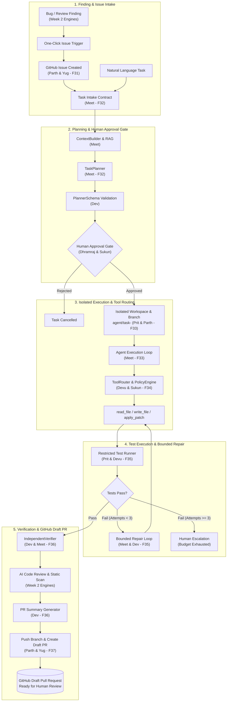

# Week 3 — Workflow Automation, GitHub Ecosystem & Production Hardening

**Project:** AI-Powered Software Development Platform  
**Duration:** 7 working days  
**Team:** Meet, Dev, Dhramraj, Yug, Om, Parth, Prit, Sukun, Keval, Devu  
**Prerequisite:** Week 2 Developer Intelligence Suite is integrated and its acceptance tests pass.

---

## 1. Week 3 Objective & Architecture

Week 3 transforms the platform from developer-intelligence tools into an **end-to-end autonomous software development workflow**. It takes a task from an identified defect or feature request all the way to a verified code change and a human-reviewable GitHub Draft Pull Request.

### Complete Workflow



> [!CAUTION]
> **Safety Boundary & Invariant Rules:**
> - The agent **NEVER** automatically merges a pull request.
> - The agent **NEVER** modifies protected branches (`main`, `master`, `production`).
> - The agent **NEVER** executes unapproved plans or shell commands outside allowlisted policies.
> - The agent **NEVER** continues repairing beyond the 3-attempt ceiling without explicit human intervention.

---

## 2. Week 3 Feature Ownership Matrix

| Feature | Lead | Collaborators | Primary Responsibilities |
|---|---|---|---|
| **F31 — GitHub Issue Creation** | **Parth** | Yug, Dhramraj, Sukun, Keval | GitHub issue creation from findings, API routes, preview UI, permission validation. |
| **F32 — Task Planner & Approval Gate** | **Meet** | Dev, Yug, Dhramraj, Om | Repository-aware planning, context integration, step sequencing, approval APIs & state gate. |
| **F33 — Isolated Workspace & File Execution** | **Prit** | Devu, Parth, Sukun, Meet | Sandboxed directory management, path traversal guards, patch application, Git branch isolation. |
| **F34 — Tool Routing & Policy Enforcement** | **Devu** | Prit, Sukun, Yug | Command allowlists, tool argument validation, permission matrix, execution timeouts. |
| **F35 — Test Runner & Bounded Repair** | **Meet** | Dev, Prit, Devu, Keval | Restricted test invocation, failure traceback diagnosis, targeted patching, max 3 repair attempts. |
| **F36 — Independent Verification & PR Summary** | **Dev** | Meet, Keval, Om | PASS/FAIL/INCONCLUSIVE independent evaluation, evidence-backed PR summary generator. |
| **F37 — GitHub Branch Push & Draft PR** | **Parth** | Yug, Dhramraj, Sukun | Branch push, GitHub Draft PR opening, linking originating issue and test evidence. |
| **F38 — Task Timeline & Workflow UI** | **Dhramraj** | Yug, Om, Keval | Unified Task Timeline (Planning → Approved → Editing → Testing → Verifying → PR), diff viewer. |
| **F39 — Persistence, Checkpoints & Traceability** | **Om** | Yug, Meet, Parth | Task run persistence, step checkpoints, issue-to-task-to-PR relational traceability. |
| **F40 — Security, Acceptance & Release Gate** | **Sukun** | Keval and all feature leads | Red team attack matrix, prompt injection defenses, credential sanitization, release signoff. |

---

## 3. Existing Week 2 Components Reused in Week 3

Week 3 directly consumes the intelligence engines and context infrastructure from Week 2:

| Week 2 Component | Role in Week 3 Autonomous Workflow |
|---|---|
| **Code Explanation** | Helps TaskPlanner understand complex symbols and callers before proposing implementation steps. |
| **Bug Detection** | Feeds confirmed defects directly into One-Click GitHub Issue creation and task intake. |
| **Test Generation** | Automatically generates new unit tests or updates existing suites during task execution. |
| **AI Code Review** | Runs against the final workspace diff prior to PR creation to generate structured review findings. |
| **ContextBuilder & RAG** | Supplies token-bounded repository overview, callers, and chunks to the TaskPlanner. |
| **Analysis Schemas** | Reuses `BugFinding`, `ReviewReport`, and `SourceReference` structures for end-to-end traceability. |
| **LLMGateway** | Strictly enforces the Google Gemini and Groq provider policy across all planning and repair steps. |

---

## 4. Day-by-Day Implementation Roadmap

### DAY 1 — GitHub Issue Creation and Task Intake

**Goal:** A developer can turn an existing bug or review finding into a GitHub issue and initiate a development task from an issue or natural-language request.

#### Parth — GitHub Issue Integration (F31 Lead)
- Implement `GitHubService.create_issue(owner, repo, title, body, labels)` using GitHub App installation tokens.
- Format issues with:
  - Problem summary and severity category.
  - Line references and verified code snippets.
  - Reproduction steps and proposed remediation.
  - Deep link back to the originating platform finding ID.
- Handle rate limits, missing permissions, and duplicate request idempotency.

#### Yug — Issue Creation API
- Implement `POST /api/v1/repositories/{id}/issues`:
  - Accepts `finding_id` reference.
  - Verifies finding belongs to the caller's repository.
  - Resolves stored finding server-side.
  - Returns `{ issue_number, issue_url, status: "created" }`.

#### Dhramraj — Create Issue UI
- Add "Create GitHub Issue" action in Bug Inspector and Code Review drawers.
- Show preview modal with editable title and markdown body.
- Display clickable link to the created GitHub issue with persistent issue badge.

#### Meet — Issue-to-Task Context Intake
- Implement `IssueTaskAdapter` converting GitHub issue body/labels into structured task objectives.
- Bind issue metadata (`issue_number`, `issue_url`) into the task context for end-to-end traceability.

---

### DAY 2 — Development Task Planner and Human Approval

**Goal:** Convert task intake into a validated, reviewable implementation plan with server-enforced human approval.

#### Meet — TaskPlanner (F32 Lead)
- Build `TaskPlanner` leveraging `ContextBuilder` and hybrid RAG:
  - Analyzes task objectives and retrieves relevant codebase context.
  - Identifies target files, functions, and affected callers.
  - Generates ordered implementation steps (`StepType`: `READ`, `EDIT`, `TEST`, `VERIFY`).
  - Estimates risk level, required test strategy, and token budget.
- Guard against hallucinated file paths by cross-referencing `repository_files`.

#### Dev — Planner Schema & Validation
- Implement strict Pydantic schemas:
  - `ImplementationStep`: `step_number`, `action`, `target_file`, `description`, `dependencies`.
  - `TaskPlan`: `plan_id`, `version`, `goal`, `steps`, `affected_files`, `test_strategy`, `risks`.
- Enforce plan versioning (any re-planning generates a new version, invalidating prior approval).

#### Yug — Task & Approval Lifecycle APIs
- Register endpoints:
  - `POST /api/v1/tasks` (create task and generate plan).
  - `GET /api/v1/tasks/{task_id}` (retrieve status and active plan).
  - `POST /api/v1/tasks/{task_id}/approve` (approve plan version).
  - `POST /api/v1/tasks/{task_id}/reject` (reject plan with feedback).
- Validate that approval transitions state to `APPROVED` and records `user_id` and timestamp.

#### Sukun — Approval Security Gate
- Enforce approval checks on the backend: reject any execution attempt if `status != APPROVED`.
- Verify user authorization: users can only approve tasks in repositories they own.

#### Dhramraj — Task Planning & Approval UI
- Build the New Task workspace:
  - Input field for task prompt or GitHub issue selector.
  - Structured plan view: expandable steps, affected files badges, and risk warnings.
  - Prominent "Approve & Execute" and "Reject / Revise" buttons.

---

### DAY 3 — Isolated Workspace, Tool Routing and Code Execution

**Goal:** Execute approved plan steps inside an isolated branch and workspace via validated, policy-enforced tools.

#### Prit — WorkspaceManager (F33 Lead)
- Create disposable local workspaces under `.workspaces/task-<task_id>/`.
- Check out the base repository revision.
- Implement filesystem operations:
  - `read_file(path)`
  - `write_file(path, content)`
  - `apply_patch(path, patch)`
  - `get_diff()`
- Strict boundary check: reject any path containing `..`, absolute paths outside workspace, or symlinks.

#### Parth — Git Branch Isolation
- Create isolated Git branch: `agent/task-<task_id>` from the repository default branch.
- Track modified files and prepare clean atomic commits for each completed plan step.

#### Devu — ToolRouter & PolicyEngine (F34 Lead)
- Build tool registry with strict argument schemas.
- PolicyEngine intercepts every tool call:
  - Validates repository scope and read/write permissions.
  - Enforces per-step timeout (default 30s) and file-size ceiling (max 1MB).
  - Logs tool invocations with sanitized parameters to `agent_actions`.

#### Meet — Agent Execution Loop
- Coordinate plan step execution:
  - Dispatches steps sequentially to `ToolRouter`.
  - Records step completion status and evidence.
  - Halts execution immediately upon unexpected tool failure or loop detection (3 identical actions).

#### Yug — Execution Lifecycle APIs
- Implement execution endpoints:
  - `POST /api/v1/tasks/{task_id}/execute`
  - `POST /api/v1/tasks/{task_id}/pause`
  - `POST /api/v1/tasks/{task_id}/resume`
  - `POST /api/v1/tasks/{task_id}/cancel`
  - `GET /api/v1/tasks/{task_id}/events` (SSE stream for live execution logs)

#### Dhramraj — Execution Timeline UI
- Live activity timeline tracking states:  
  `Planning → Approved → Editing → Testing → Verifying → Complete`.
- Display live terminal logs, completed step checkmarks, and Pause/Cancel controls.

---

### DAY 4 — Restricted Test Execution and Bounded Auto-Fix

**Goal:** Run framework tests in a restricted environment, diagnose failures, and perform up to 3 automated repair iterations.

#### Prit & Devu — Restricted Test Runner (F35 Support)
- Execute allowlisted test runners (`pytest`, `unittest`, `npm test`).
- Enforce strict limits: 60s timeout, 512MB RAM cap, zero external network egress.
- Capture stdout, stderr, exit code, and execution duration.

#### Meet — Bounded Repair Loop (F35 Lead)
- Implement automated self-healing loop:
  1. Trigger test runner on modified files.
  2. If tests fail, parse error tracebacks and failing assertions.
  3. Query `ContextBuilder` for the failing function and caller context.
  4. Prompt Gemini/Groq for a targeted repair patch.
  5. Apply patch via `WorkspaceManager.apply_patch()`.
  6. Re-run tests.
  7. **Ceiling Rule**: Max **3 repair iterations**. If tests still fail after 3 attempts, halt execution and transition task to `NEEDS_HUMAN` with failure diagnosis.

#### Dev — Failure Diagnosis & Patch Validation
- Verify that proposed patches address the test failure without reverting previously passing tests.
- Prevent infinite oscillation between two competing patch strategies.

#### Dhramraj — Test & Repair Timeline UI
- Display test run cards with passing/failing status, execution time, and error logs.
- Show repair attempt counter (e.g. `Repair Attempt 2 / 3`).
- Provide human intervention alert if repair attempts are exhausted.

---

### DAY 5 — Independent Verification, Code Review and Draft PR Creation

**Goal:** Validate code changes independently against the original requirements and create a GitHub Draft PR.

#### Dev — IndependentVerifier & PR Summary (F36 Lead)
- Run independent evaluation:
  - Assesses whether the final diff satisfies all items in `TaskPlan`.
  - Verifies test run evidence.
  - Returns `PASS`, `FAIL`, or `INCONCLUSIVE`.
- Generate comprehensive Markdown PR summary:
  - Objective and problem statement.
  - Summary of changes and modified files list.
  - Test evidence table (commands run, pass/fail status).
  - Residual risk analysis.

#### Parth — GitHub Push & Draft PR (F37 Lead)
- Push isolated branch `agent/task-<task_id>` to remote GitHub repository.
- Open GitHub Draft Pull Request via `GitHubService.create_pull_request(..., draft=True)`.
- Set PR title, inject generated Markdown summary, and link the originating issue (`Fixes #<issue_number>`).
- Store PR URL and number in `task_runs`.

#### Yug — PR Creation API
- `POST /api/v1/tasks/{task_id}/create-pr`:
  - Validates that task verification returned `PASS`.
  - Rejects PR creation if verification failed or tests did not pass.
  - Idempotent: repeated calls return the existing PR metadata without creating duplicate PRs.

#### Dhramraj — PR Status & Review Screen
- Final review screen displaying:
  - Side-by-side diff viewer.
  - Verification badge (`VERIFICATION: PASSED`).
  - GitHub Draft PR link button (`Open PR #<id> on GitHub`).

---

### DAY 6 — Security, Reliability and Performance Hardening

**Goal:** Stress-test against prompt injection, verify multi-tenant isolation, sanitize logs, and measure performance against SLA benchmarks.

#### Sukun — Security Red Team (F40 Lead)
- Execute comprehensive attack matrix:
  - Prompt injection embedded in repository files, comments, and commit messages.
  - Path traversal attempts (`../../etc/passwd`).
  - Unauthorized task approval and cross-tenant repository access attempts.
  - Secret leakage scanning across generated code, commit messages, and PR descriptions.

#### Meet — Retrieval & Agent Performance
- Benchmark context retrieval latency (target P95 < 400ms).
- Verify bounded token usage across planning, execution, and repair loops.
- Ensure model calls enforce timeouts and failover between Gemini and Groq.

#### Keval — Full Regression Suite
- Run complete end-to-end regression across all backend tests and frontend production builds.
- Confirm zero test regressions from Week 1 and Week 2.

---

### DAY 7 — Final Integration & Live Demonstration

**Goal:** Deliver the end-to-end demonstration on a real GitHub repository and publish final documentation.

#### Live Demo Acceptance Flow
1. Open Workbench on an authorized GitHub repository.
2. Run Bug Detection on a source file -> Inspect finding -> Click **"Create GitHub Issue"**.
3. Navigate to **New Task** -> Select the created issue -> Generate implementation plan.
4. Review the plan -> Click **"Approve Plan"**.
5. Watch live Execution Timeline: branch created, code edited, tests executed.
6. Trigger an intentional failure -> Verify bounded repair fixes the failure on Attempt 2.
7. Verify Independent Verifier outputs `PASS`.
8. Confirm Draft PR is opened on GitHub with complete markdown summary, test evidence, and issue backlink.
9. Verify zero manual interventions were needed between Plan Approval and Draft PR.

---

## 5. Shared API Specifications for Week 3

```yaml
paths:
  /api/v1/repositories/{id}/issues:
    post:
      summary: Create a GitHub issue from an intelligence finding
      requestBody:
        content:
          application/json:
            schema:
              type: object
              required: [finding_id]
              properties:
                finding_id: {type: string}
                title: {type: string}
                additional_notes: {type: string}
      responses:
        201:
          content:
            application/json:
              schema:
                type: object
                properties:
                  issue_number: {type: integer}
                  issue_url: {type: string}
                  status: {type: string}

  /api/v1/tasks:
    post:
      summary: Create a task and generate implementation plan
      requestBody:
        content:
          application/json:
            schema:
              type: object
              required: [repository_id]
              properties:
                repository_id: {type: string, format: uuid}
                prompt: {type: string}
                github_issue_number: {type: integer, nullable: true}
      responses:
        201:
          content:
            application/json:
              schema: {$ref: '#/components/schemas/TaskWithPlan'}

  /api/v1/tasks/{task_id}/approve:
    post:
      summary: Approve task plan and authorize execution
      requestBody:
        content:
          application/json:
            schema:
              type: object
              required: [plan_version]
              properties:
                plan_version: {type: integer}
      responses:
        200:
          content:
            application/json:
              schema: {type: object, properties: {status: {type: string, example: "APPROVED"}}}

  /api/v1/tasks/{task_id}/execute:
    post:
      summary: Start execution of approved task
      responses:
        202:
          content:
            application/json:
              schema: {type: object, properties: {status: {type: string, example: "EXECUTING"}}}

  /api/v1/tasks/{task_id}/create-pr:
    post:
      summary: Push task branch and open GitHub Draft PR
      responses:
        201:
          content:
            application/json:
              schema:
                type: object
                properties:
                  pull_request_number: {type: integer}
                  pull_request_url: {type: string}
                  branch_name: {type: string}
                  status: {type: string}
```

---

## 6. Definition of Done & Release Criteria

The Week 3 milestone passes when all of the following are demonstrated:

1. **Complete E2E Chain**: A user can go from Bug Finding -> GitHub Issue -> Task Plan -> Approval -> Sandbox Edit -> Test & Repair -> Verification -> GitHub Draft PR.
2. **Strict Server-Side Gates**: Unapproved plans cannot modify files; failed verification blocks PR creation.
3. **Bounded Repair**: Test repair halts and requests human help after exactly 3 attempts.
4. **Isolated Workspaces**: All file operations occur on dedicated `agent/task-<id>` branches with zero path traversal risk.
5. **Multi-Tenant Security**: Zero secret leaks, prompt injection fences verified, cross-tenant access blocked.
6. **Provider Conformance**: All planning, repair, and verification calls exclusively use approved Gemini and Groq models.
7. **Regression Green**: 100% backend tests passing, >= 70% coverage, and clean frontend production build.
