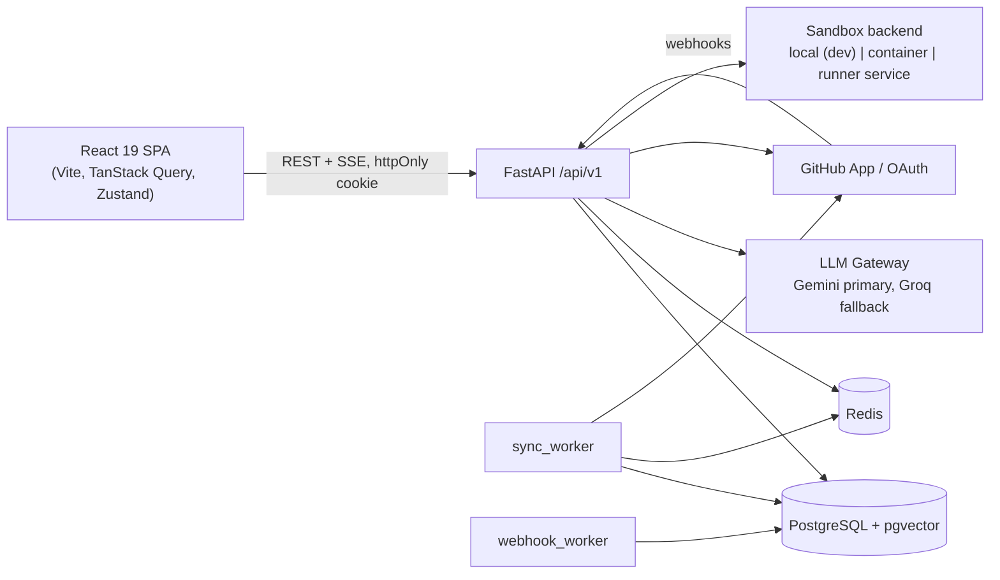

# AI-Powered Software Development Platform

A repository-aware developer intelligence and agentic software engineering platform. It connects to GitHub repositories, indexes their code (AST parsing, symbol graphs, hybrid vector + lexical retrieval), answers grounded questions about the code, runs AI-assisted analysis (explain, bug detection, test generation, code review) and executes human-approved development tasks in an isolated workspace that ends in a **GitHub draft pull request** — never an automatic merge.

> Documentation in this repository describes the implementation as verified against the source code at commit `5d0b3ff` (2026-11-16). Where a capability is partial or planned, it is marked as such. See [Feature status](documentation/01-overview/FEATURES.md) and [Known limitations](documentation/08-reference/KNOWN_LIMITATIONS.md).

---

## What it does

| Area | Capability | Status |
|---|---|---|
| Repository intelligence | GitHub App connect, clone, walk, tree-sitter parsing (Python, JS/TS, Go, Rust, Java, C, C++), symbols, dependency edges, symbol ranking | Implemented |
| Retrieval | pgvector HNSW vector search + PostgreSQL full-text (code-aware tokenizer) fused with RRF, optional 1-hop graph expansion, cross-encoder reranking, two-level cache | Implemented |
| Repository chat | Grounded answers with file/line citations; "normal" RAG mode and bounded read-only "agentic" mode | Implemented (non-streaming; history supplied by the client) |
| Developer intelligence | Explain code, detect bugs (AST rules + static scanners + LLM), generate framework-aware tests, AI code review with optional GitHub publication | Implemented (static scanners depend on tools present on the host) |
| Agentic tasks | Issue/requirement intake → LLM plan → human approval gate → isolated workspace → edits → tests → bounded repair (≤3) → independent verification → authorised push → draft PR | Implemented; background workflow is thread-based (see limitations) |
| Safety | Plan-hash bound approval, tool policy + risk tiers, tool/MCP approval gate, path guard, sandbox backends, taint/provenance tracking, secret redaction | Implemented |
| Operations | Durable webhook queue, Redis sync queue with leases, health/readiness, OpenTelemetry + optional Langfuse | Implemented (telemetry disabled by default) |

## Architecture at a glance



Full details: [System architecture](documentation/02-architecture/SYSTEM_ARCHITECTURE.md).

## Technology stack

- **Backend:** Python 3.11, FastAPI, Pydantic v2, SQLAlchemy 2, Alembic, Redis, tree-sitter (`tree-sitter-language-pack`), PyJWT, OpenTelemetry.
- **AI:** Google Gemini (`gemini-flash-lite-latest` chat, `gemini-embedding-001` 768-d embeddings) with Groq (`openai/gpt-oss-120b`) as fallback, cross-encoder reranker (PyTorch or ONNX).
- **Frontend:** React 19, TypeScript, Vite, Tailwind CSS 4, TanStack Query 5, Zustand 5, Axios.
- **Data:** PostgreSQL with `pgvector` (local compose uses `pgvector/pgvector:pg15`; CI uses `pg16`), Redis 7.
- **Deployment:** Azure Web App (CI zip-deploy of the API), Vercel for the SPA, multi-stage Docker image and role-based worker processes (`SERVICE_ROLE`).

## Quick start (local)

```bash
cp .env.example .env          # fill in GitHub App, JWT_SECRET, Gemini/Groq keys, DB/Redis URLs
docker compose up -d postgres redis   # optional: local Postgres (host port 5433) + Redis
make migrate                  # alembic upgrade head
make run                      # backend :8000 + frontend :5173
```

- API docs: `http://localhost:8000/docs`
- Readiness: `http://localhost:8000/api/v1/health/ready`

See [Development setup](documentation/06-development/DEVELOPMENT_SETUP.md).

## Testing

```bash
make test-backend      # pytest backend/tests (coverage disabled in this target)
make test-frontend     # vitest run
```

CI runs ruff, bandit, pytest with coverage, oxlint, `tsc -b`, Vitest, a production build, PostgreSQL + pgvector migration checks, Gitleaks and pip-audit. See [Testing guide](documentation/05-testing/TESTING_GUIDE.md).

## Documentation

Start at [documentation/README.md](documentation/README.md).

## Team

Meet (repository intelligence, retrieval, task lifecycle) · Dev (AI engines, schemas, verification) · Dharmraj (frontend) · Yug (API and orchestration) · Om (database and persistence) · Parth (GitHub integration) · Prit (AST, workspace isolation) · Devu (static analysis, chunking, tool policy) · Sukun (security) · Keval (QA).
