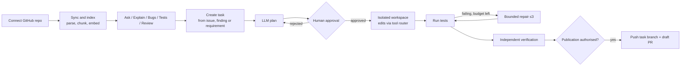

# Project Overview

## Problem

Software teams spread code review, testing, debugging, issue tracking and pull-request work across disconnected tools, and most AI coding assistants are stateless: every session starts without knowledge of the project's structure, conventions or earlier attempts. Giving an autonomous agent write access to a codebase without permissions, isolation and human checkpoints is unsafe.

## Goal

Provide one system that:

1. **Understands a repository** — indexes code structurally (AST symbols, dependency edges) and semantically (embeddings), and answers questions with verifiable file/line citations.
2. **Assists developers** — explains code, finds bugs, generates tests and reviews changes using repository context.
3. **Performs bounded engineering work** — turns an issue or requirement into a plan, waits for human approval, executes in an isolated workspace, tests, repairs (bounded), verifies independently and opens a **draft** pull request. Merging remains a human action.
4. **Remains traceable and safe** — every task step, tool call, approval, test run and repair attempt is persisted; untrusted repository/issue content is tracked and cannot escalate into command execution without approval.

## End-to-end flow



## Users and roles

| Role | Capability (server-enforced with `require_min_role` / `require_role`) |
|---|---|
| `viewer` | Read repositories, results and history they own |
| `developer` | Run analyses, create and drive tasks, list MCP servers |
| `admin` | Register/modify MCP servers and tool policies, administrative routes |

Tenant isolation: every repository/task route resolves ownership (`get_owned_repository`, `get_owned_task`) before acting.

## Repository layout

```text
backend/
  app/            FastAPI app: api/v1 routers, core (config, auth, security), models, repositories, services, workers, observability, mcp
  ai/             LLM gateway, embeddings, retrieval, context builders, prompts, agent (chat), services (planner, synthesizers, verifiers), security (provenance/taint), evaluation, workflows
  agent/tools/    Unified tool registry, router, JSON-Schema validation, rate limiting, adapters (builtin, MCP)
  sandbox/        Workspace manager, path guard, command runner, sandbox backends (local, container, runner client), test runner, diff verifier, Gitleaks
  scanner/        Walker, tree-sitter parser, symbols/graph, framework detection, AST rules, taint analysis, Semgrep/OSV/SCIP runners, test mapping
  indexer/        Symbol-aware chunker and incremental indexer
  review/         Static reviewer (ruff, bandit, eslint, biome)
  runner/         Standalone Runner Service (FastAPI) for isolated execution hosts
  migrations/     Alembic revisions
  scripts/        Benchmarks, security gate, OpenAPI type generation, seeding
  tests/          pytest suites and fixtures
frontend/src/     React SPA: pages, components, hooks, services, stores, realtime, types, tests
tests/e2e/        Tiered end-to-end pytest suites and a Playwright spec
loadtests/        Locust file and load/soak runner
Docs/             Documentation
```

## Size (commit 5d0b3ff)

| Item | Count |
|---|---|
| Backend Python (excluding tests) | ~118k lines |
| Backend tests | 260 test modules, ~2,700 test functions |
| Frontend TypeScript/TSX | ~47.5k lines (incl. tests, mocks, generated types) |
| Frontend test files | 33 Vitest files |
| API operations | 129 (109 paths) |
| Database tables | 26 |
| Alembic revisions | 20 |
