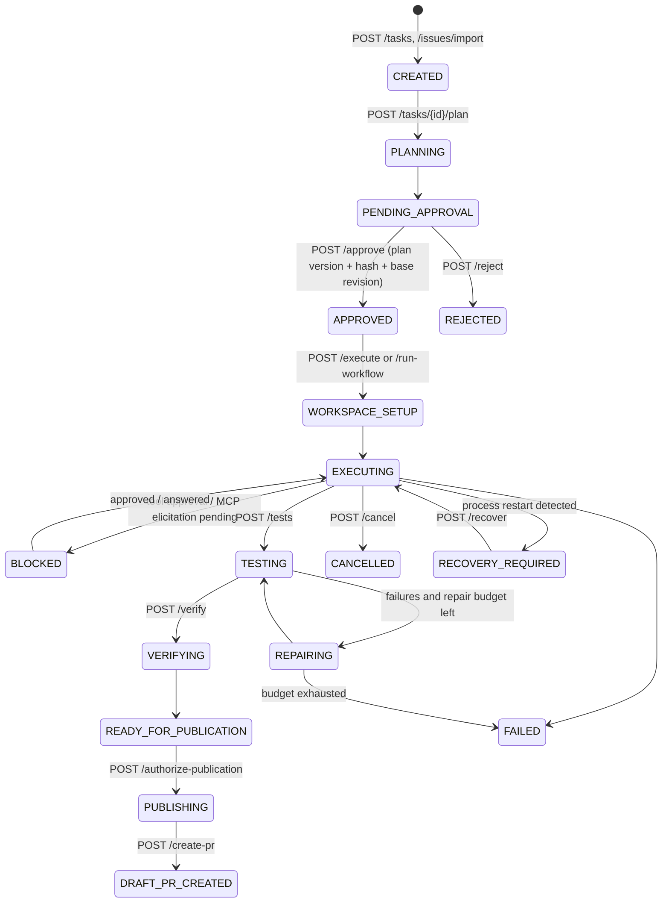
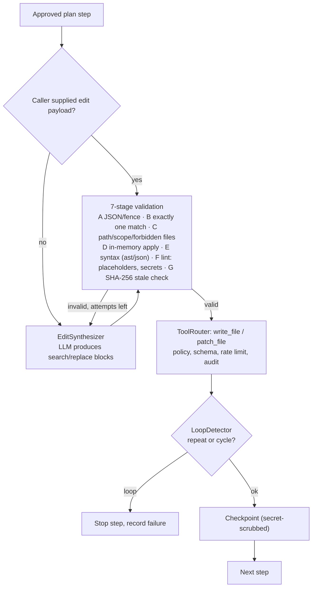
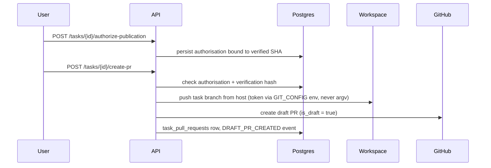

# Agent Execution Architecture

The task workflow turns a requirement, GitHub issue or analysis finding into a verified draft pull request. Every transition is server-enforced and persisted.

## 1. Task lifecycle

`TaskStatus` values (`backend/app/models/task.py`): `CREATED, PLANNING, PENDING_APPROVAL, APPROVED, REJECTED, WORKSPACE_SETUP, EXECUTING, TESTING, REPAIRING, VERIFYING, READY_FOR_PUBLICATION, PUBLISHING, DRAFT_PR_CREATED, FAILED, CANCELLED, RECOVERY_REQUIRED, BLOCKED`.

`/pause` and `/resume` act on the workspace/execution rather than adding a status.

## 2. Planning

| Step | Component |
|---|---|
| Requirement discovery and context | `ai/services/task_requirement_discovery.py`, `ai/context/task_context.py` (repository intelligence, blast radius) |
| Hierarchical localisation (file → symbol → edit location) | `ai/services/hierarchical_localizer.py` |
| Structured plan (steps, expected files, tests to run, risks, permissions, budget) | `ai/services/task_planner.py` with deterministic fallback |
| Completeness/gap check | `ai/services/task_completeness_checker.py` |
| Plan persistence | `task_plans` with `version` and `plan_hash` |

## 3. Human approval gate

- Approval records the plan version, `plan_hash` and `base_revision`. Execution is refused if the plan or base revision changed after approval.
- The same `task_approvals` table records **tool approvals** (risky tool calls bound to an argument hash, with expiry and single consumption) and **MCP elicitations** (form/URL requests answered by the user).
- Merging is never automated; the end state is a draft PR.

## 4. Execution loop

- `AgentExecutionLoop` (`ai/services/agent_execution_loop.py`) runs steps with an execution budget, checkpoints and a `LoopDetector` that flags immediate repeats and repeating cycles (window 4, 2 repetitions).
- Edit synthesis allows at most 3 attempts per edit (1 + 2 retries). Failure fails the step closed; no content is reused from other steps.

## 5. Testing and bounded repair

- Tests run through the restricted test runner (`sandbox/test_runner.py`) in the configured sandbox backend; results are parsed from JUnit XML with coverage where available.
- `BoundedRepairLoop` allows **3 task-level repair attempts** (`MAX_TASK_REPAIR_ATTEMPTS`). Each attempt: classify failure (infra / test bug / code bug), diagnose traceback, synthesise a patch (`LLMRepairSynthesizer`), deduplicate by patch hash, forbid test-file edits unless the plan scopes them, re-run tests.
- Budget exhaustion ends in a safe failure that requires a human.

## 6. Independent verification

`IndependentVerifier` checks the workspace diff against the approved scope (forbidden paths, unexpected files), scans added lines for secrets (regex engine plus Gitleaks when available), runs requirement-to-code verification and an optional LLM-as-judge check citing diff hunks, and records a `verification_diff_hash`. Diffs are streamed with a 10 MB cap and early path checks.

## 7. Publication

Protected branches are refused; pushes run on the API host so credentials never enter the sandbox; failed pushes are reported as failures.

## 8. Background workflow and recovery

- `POST /tasks/{id}/run-workflow` runs the post-approval steps (execute → test → repair → verify → prepare publication). With async execution it returns `202` and progress is available at `/workflow-status`.
- **Current implementation:** the workflow runs in a daemon thread; the workflow registry is in memory. DBOS decorators wrap steps but no DBOS runtime is launched, so steps execute natively. Durability comes from persisted checkpoints, events and startup reconciliation, not from a workflow engine.
- On startup, interrupted tasks are marked `RECOVERY_REQUIRED`; `/recover` reconciles the workspace and resumes from checkpoints.

## 9. Sandbox backends

| Backend (`SANDBOX_BACKEND`) | Use | Isolation |
|---|---|---|
| `local` | Development only (refused in production) | Subprocess in a git worktree with path guard, command allowlist, timeouts, output cap, secret redaction, hooks disabled |
| `container` | Host with Docker | No network in test phase, read-only root, noexec `/tmp`, UID/GID 10001, dropped capabilities, `no-new-privileges`, 2 CPU / 4g / 512 PIDs, gVisor `runsc` when available |
| `runner` | Production | API calls the Runner Service over HTTP with a bearer secret; the runner uses the container backend; outage fails closed (no host fallback) |

Two-phase pipeline: phase A installs dependencies with limited network (120 s), phase B runs tests offline.
