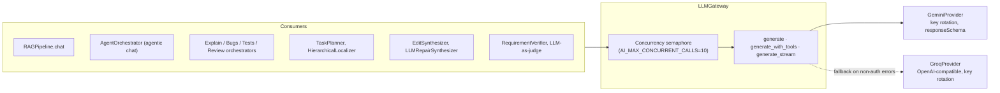
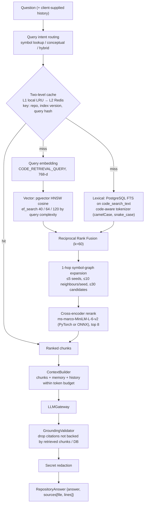

# AI and RAG Architecture

## 1. LLM gateway (`backend/ai/llm`)

All inference goes through `LLMGateway` (`ai/llm/client.py`). Feature code never calls a provider SDK directly.

| Concern | Implementation |
|---|---|
| Providers | Gemini (`GEMINI_CHAT_MODEL`, default `gemini-flash-lite-latest`) primary; Groq (`GROQ_CHAT_MODEL`, default `openai/gpt-oss-120b`) fallback. Comma-separated key lists enable rotation. Only these providers are permitted (ADR-008). |
| Retries / timeout | Provider retries (`AI_MAX_RETRIES=3`), request timeout `AI_REQUEST_TIMEOUT_SECONDS=30` |
| Fallback | To the fallback provider on non-authentication errors; auth errors do not fall back by default |
| Structured output | Pydantic schemas; Gemini `responseSchema` / Groq JSON schema; `OutputValidator` repair loop (up to `AI_MAX_REPAIR_ATTEMPTS=2`) |
| Tool calling | Normalised tool-call request/response across Gemini and Groq (`generate_with_tools`) |
| Streaming | `generate_stream` exists in the gateway; the chat endpoint does not stream tokens |
| Telemetry | Stage metrics (`app/core/stage_metrics.py`), OpenTelemetry GenAI span attributes, optional Langfuse export; prompt/response capture off by default |
| Prompts | Plain-text templates in `ai/prompts/*.txt` (14), validated at startup; `PromptBuilder` keeps instructions in the system message and repository content in a delimited data section |

## 2. Embeddings (`backend/ai/embeddings`)

| Setting | Value |
|---|---|
| Provider / model | Gemini `gemini-embedding-001` |
| Dimensions | 768 (`EMBEDDING_DIMENSIONS`), validated on write |
| Task types | `RETRIEVAL_DOCUMENT` for chunks, `CODE_RETRIEVAL_QUERY` for queries |
| Profile | `EMBEDDING_PROFILE_VERSION=v2`; cache keys and compatibility checks include profile version and task type |
| Normalisation | L2-normalised on write and query; zero/NaN/wrong-dimension vectors rejected |
| Throughput control | Distributed rate limiter (`EMBEDDING_MAX_REQUESTS_PER_MINUTE=120`, concurrency 5), batching |
| Caching | `CachedEmbeddingService` (Redis) |
| Chunk text | A contextual header (path, enclosing class, signature) is prepended to the embedded text only; stored `content` stays raw so line citations remain exact |
| Optional local model | `nomic-ai/CodeRankEmbed` behind `ALLOW_LOCAL_EMBEDDINGS=true` |

## 3. Retrieval pipeline (`backend/ai/retrieval`)

Production workers load the PyTorch reranker and run one inference during startup. Budget for model download on a fresh worker or provision the model cache before launch. The fixture benchmark reports this startup cost separately and times every labelled request, including the first one served.

- All vector and lexical queries are scoped by `repository_id`.
- HNSW settings: `RETRIEVAL_HNSW_*_EF_SEARCH`, iterative scan `relaxed_order`; applied inside a transaction savepoint.
- Cache invalidation: a completed sync bumps the repository's index version; old keys become unreachable and are garbage-collected with bounded `SCAN`.
- Redis failures degrade to local cache and direct execution.

## 4. Repository chat modes

| Mode | Behaviour |
|---|---|
| `normal` | `RAGPipeline.chat`: retrieval → context → single LLM call → grounding |
| `agentic` | `AgentOrchestrator`: bounded tool loop with read-only tools `search_code`, `read_file_range`, `get_symbol`, `find_callers`; limits: 3 rounds, 6 tool calls, 4 model calls, 2 parallel tools, 12k input / 2k output tokens, 35 s per request, 5 s per tool, 8 KB per tool result, 24 KB total evidence. On budget exhaustion it answers from collected evidence. Enabled by `AGENTIC_CHAT_ENABLED`. |

Project memory entries for the repository are retrieved and passed to the pipeline as context. Conversation history is supplied by the client on each request.

## 5. Context building and token budgets (`backend/ai/context`)

- Token counting with `tiktoken`; provider-aware safety factors (Gemini estimates scaled up) and calibration against reported usage.
- Per-feature budgets: explain 4,000, bugs 6,000, tests 6,000, review 8,000 tokens (`CONTEXT_BUDGET_*`).
- Feature builders: `explanation.py`, `bug_context.py`, `test_context.py`, `review_context.py`, `task_context.py`; shared `IntelligenceContext` keeps the target snippet and truncates distant callers first.
- Repository data is rendered inside randomised delimiters and labelled untrusted.

## 6. Repository intelligence (`backend/ai/intelligence`)

Snapshot manager, related-file discovery (imports, symbol edges, PageRank importance, Git co-change coupling) and dependency impact analysis feed explanations, planning and blast-radius estimation.

## 7. Provenance and taint tracking (`backend/ai/security`)

Untrusted inputs (issue text, repository content, tool output) carry provenance and trust levels. The taint policy engine blocks tainted values from reaching command-executing tools unless re-approved, and records decisions in a security audit log. See [Security](../04-security/SECURITY.md).

## 8. Evaluation (`backend/ai/evaluation`)

- `quality_gate.py`: metric thresholds; a metric below threshold fails the gate.
- `fixture_loader.py`: labelled fixtures in `backend/tests/evaluation/fixtures` (defects, clean code, false positives, security, concurrency, performance, resource management, error handling).
- `mini_swebench/`: 25 small bug-fix tasks (issue, reproduction test, regression test) with an isolated executor and aggregate runner.
- Nightly CI workflow runs the quality suite on fixtures.

Benchmark numbers and their conditions are in the [Testing guide](../05-testing/TESTING_GUIDE.md#benchmarks).
