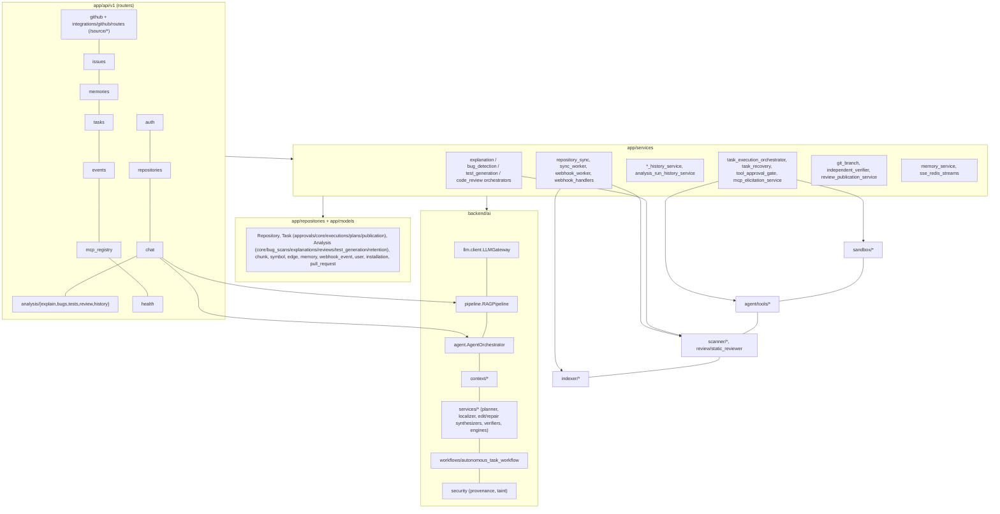
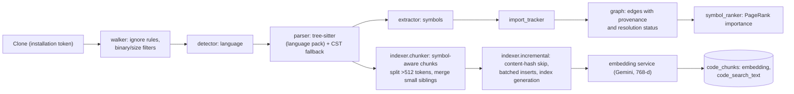

# Backend Architecture

Python 3.11 FastAPI application. Entry points: `main.py` (repository root, adds `backend/` to `sys.path`) → `backend/app/main.py` (application factory).

## Layers

## Application lifecycle (`app/core/lifespan.py`)

On startup the lifespan:

1. Configures logging (JSON formatter with request/trace ids, secret-redacting filter) and OpenTelemetry (if enabled).
2. Builds shared services on `app.state`: LLM gateway (primary + fallback provider, concurrency semaphore), embedding service, retrieval pipeline (vector, lexical, fusion, reranker from `create_reranker()`, optional `SymbolGraphExpander`, two-level cache), RAG pipeline, agent orchestrator.
3. Validates that required prompt templates exist.
4. Runs startup reconciliation (unless `RUN_STARTUP_RECONCILIATION=false`): stale sync jobs, interrupted tasks, orphaned workspaces.
5. Starts the embedded webhook worker loop (unless `DISABLE_EMBEDDED_WEBHOOK_WORKER`) and the embedded sync worker loop (unless `DISABLE_EMBEDDED_SYNC_WORKER`, which defaults to `true` in production).
6. On shutdown, drains Redis connection pools and stops loops.

## Configuration

`app/core/config.py` (`pydantic-settings`) is the single settings source. In production (`APP_ENV=production`) validation fails startup when: `JWT_SECRET` is shorter than 32 characters, has fewer than 12 distinct characters or matches a known dummy value; `ENABLE_DEV_LOGIN` is true; `COOKIE_SECURE` is false; CORS origins are empty or contain localhost; `CORS_ORIGIN_REGEX` is a wildcard or not anchored with `^…$`; JWT issuer/audience are empty. See [Environment configuration](../07-deployment/ENVIRONMENT_CONFIGURATION.md).

## Persistence

- SQLAlchemy 2 models in `app/models`; sync sessions (`get_db`) and an async engine for AI retrieval.
- Pool sizes are chosen per service role (`_get_role_pool_size` in `app/core/database.py`).
- Data access is organised as repository classes; the task and analysis repositories are split into aggregate mixins (`app/repositories/task/*`, `app/repositories/analysis/*`).
- Migrations: Alembic, single linear chain, 20 revisions. See [Database architecture](DATABASE_ARCHITECTURE.md).

## Redis usage (`app/core/redis.py`)

Thread/coroutine-safe singleton clients with bounded pools (`REDIS_MAX_CONNECTIONS`, default 50) and retry with backoff. Used for: JWT blocklist, OAuth state, rate limits, sync job queue and worker heartbeats/locks, retrieval and embedding caches, SSE streams, installation token cache.

## Scanner and indexer pipeline

## Static analysis integrations

| Tool | Used by | Availability |
|---|---|---|
| ruff, bandit | Static reviewer, static bug scanner | Installed from `requirements-dev.txt`; not in the production image |
| eslint, biome | Static reviewer (JS/TS) | Invoked with `npx --no-install`; only if present in the analysed repository/host |
| Semgrep CE, OSV-Scanner, Gitleaks, SCIP | Bug detection / verification | Optional binaries; results report when a scanner is unavailable |
| Built-in AST rules, taint analyzer, multi-language security scanner | Bug detection | Always available (pure Python) |

Scanner invocations are batched per scanner (one process per scanner, not per file), run concurrently, prefix targets with `--`, and use a minimal environment.

## Key cross-cutting rules

- **Single LLM entry point:** all inference goes through `LLMGateway`.
- **Prompt separation:** system prompts contain instructions only; repository content is rendered as delimited, untrusted data.
- **Redaction:** responses, logs, checkpoints and persisted payloads pass through `app/core/secret_redaction.py`.
- **Ownership:** every repository/task route resolves ownership before acting.
