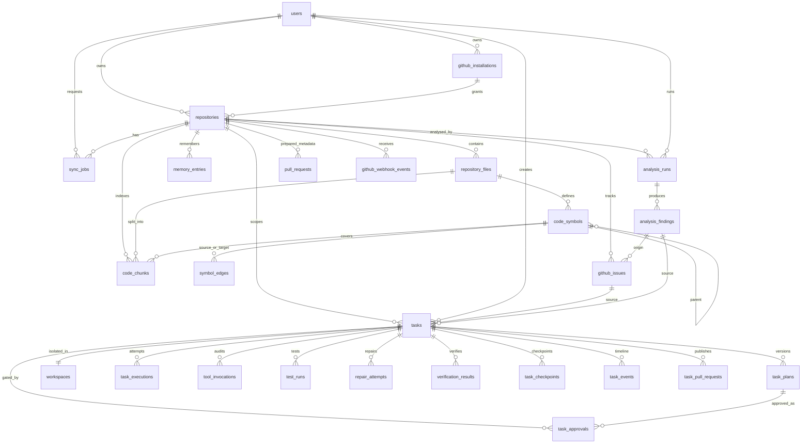

# Database Architecture

PostgreSQL with the `pgvector` extension. SQLAlchemy 2 declarative models live in `backend/app/models`; schema changes are made only through Alembic (`backend/migrations`).

## Entity relationships

## Tables

| Group | Table | Purpose / key columns |
|---|---|---|
| Identity | `users` | `github_id`, `login`, `email`, `role` (viewer/developer/admin) |
| | `github_installations` | GitHub App installations per user (`installation_id`, `permissions`) |
| Repository content | `repositories` | Connected repos; `sync_status`, `active_index_generation`, `active_commit_sha`, `last_indexed_commit_sha`, `auto_sync_enabled`, `pr_review_enabled` |
| | `sync_jobs` | Queued/running/completed sync jobs |
| | `repository_files` | Indexed files (`path`, `language`, `content_hash`, `line_count`) |
| | `code_symbols` | Functions/classes/methods with ranges, `signature`, `parent_id`, `importance_score` |
| | `symbol_edges` | Calls/imports with `edge_type`, `provenance`, `resolution_status`, `confidence`, `weight` |
| | `code_chunks` | Retrieval units: `content`, `code_search_text` (FTS), `embedding vector(768)`, `content_hash`, `token_count` |
| Memory | `memory_entries` | Project memory (`type_`, `content`, `source`, `status`, `embedding vector(768)`) |
| Analysis | `analysis_runs` | One run per explain/bugs/tests/review request; `feature_type`, `status`, `result_payload`, `source_revision` |
| | `analysis_findings` | Structured findings (`category`, `severity`, location, `evidence`, `suggested_fix`, `confidence`, `rule_id`) |
| Issues | `github_issues` | Imported/created issues, optional `origin_finding_id` |
| Tasks | `tasks` | Lifecycle status, source, `base_revision`, `plan_version`, `approved_plan_version`, repair counters |
| | `task_plans` | Versioned plans with `plan_hash`, steps, expected files, tests, risks, permissions, budget |
| | `task_approvals` | Plan approvals and tool/MCP approvals (`approval_type`, `argument_hash`, `risk_level`, `expires_at`, `consumed_at`) |
| | `workspaces` | Isolated workspace path, task branch, base/current revision, cleanup time |
| | `task_executions`, `tool_invocations`, `test_runs`, `repair_attempts`, `verification_results`, `task_checkpoints`, `task_events` | Full audit trail of execution |
| | `task_pull_requests` | Published draft PRs (`pr_number`, `pr_url`, `head_sha`, `is_draft`) |
| | `pull_requests` | Prepared PR metadata from the `/source/pr-metadata` flow (`task_id` has no foreign key) |
| Webhooks | `github_webhook_events` | Durable queue: `delivery_id`, `status`, `attempts`, `available_at`, `lease_expires_at`, `last_error`, `replay_count` |

## Indexes and vector search

- HNSW indexes on `code_chunks.embedding` and `memory_entries.embedding` (cosine).
- GIN full-text index on `code_chunks.code_search_text`.
- `(repository_id, content_hash)` and other query indexes; redundant indexes removed in `daf0c05ab34b`.

## Deletion and retention

- Foreign keys from repository-scoped tables use `ON DELETE CASCADE` (hardened in `f3c4d5e6a7b8` and `l9c0d1e2f3a4`). Deleting a repository also clears workspaces and Redis keys through the repository deletion service.
- Analysis runs older than `RETENTION_DAYS` (default 30) are purged by the sync worker's maintenance loop every `RETENTION_PURGE_INTERVAL_SECONDS` (default 3600).

## Migrations

Single linear Alembic chain (20 revisions), from `24498ac67b3e` (enable pgvector) to head `daf0c05ab34b` (task indexes, redundant indexes dropped). Order below is the actual `down_revision` chain.

| Revision | Change |
|---|---|
| `24498ac67b3e` | Enable pgvector |
| `5f6dc031921b` | Identity schema |
| `aef3bb17eb34` | Repository content tables |
| `cb4e2a7d0f31` | Sync jobs |
| `e7b8c9d0f1a2` | Code chunks and memory entries |
| `f1c2d3e4b5a6` | Analysis runs and findings |
| `b627460d74e0` | `pull_requests` |
| `b3c4d5e6f7a8` | Workflow automation tables |
| `c94e1f8a2d73` | GitHub issues, task extensions |
| `d5e6f7a8b9c0` | Constraint fixes and indexes |
| `e1f2a3b4c5d6` | Webhook events, repository automation flags |
| `e8f9a0b1c2d3` | `code_search_text`, index generation tracking |
| `f3c4d5e6a7b8` | Repository deletion cascades |
| `g4d5e6f7a8b9` | Tool invocation audit fields |
| `h5e6f7a8b9c0` | Approvals for tools and MCP elicitation |
| `i6f7a8b9c0d1` | Memory embeddings + HNSW |
| `j7a8b9c0d1e2` | Symbol/edge provenance, resolution status, ranking |
| `k8b9c0d1e2f3` | `users.role` for RBAC |
| `l9c0d1e2f3a4` | FK `ondelete` policies |
| `daf0c05ab34b` | Task indexes, drop redundant indexes |

Run migrations with `alembic -c backend/alembic.ini upgrade head` (`make migrate`). In production use the one-shot `SERVICE_ROLE=migrate` instead of migrating on every replica start (`RUN_MIGRATIONS_ON_STARTUP`).
