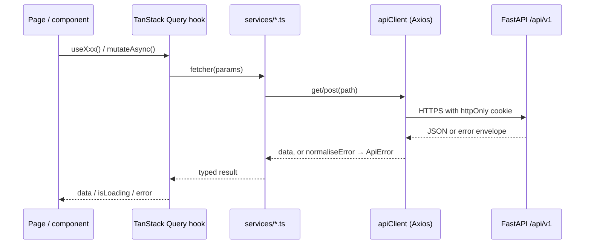

# Frontend Architecture

React 19 + TypeScript single-page application built with Vite, styled with Tailwind CSS 4.

## Stack

| Concern | Choice |
|---|---|
| Build / dev server | Vite (`npm run dev` on port 5173) |
| Routing | `react-router-dom` 7, all pages lazy-loaded |
| Server state | TanStack Query 5 hooks in `src/hooks` |
| Client state | Zustand 5: `useAuthStore` (current user), `useAppStore` (layout) |
| HTTP | Axios client `src/services/api.ts` |
| Real-time | `src/realtime` EventSource wrapper for `/api/v1/events` |
| Types | `src/types/api.gen.ts` generated from OpenAPI (`backend/scripts/generate_openapi_types.py`) plus hand-written domain types (`analysis.ts`, `task.ts`, `memory.ts`) |
| Mocking | `src/mocks` handlers + `src/lib/msw`, enabled only when `VITE_ENABLE_MSW=true` in development and in tests |
| Lint / test | oxlint, Vitest + Testing Library + jsdom |

## Routes

| Path | Page | Purpose |
|---|---|---|
| `/login`, `/auth/callback` | `Login`, `AuthCallback` | GitHub OAuth (dev login button only when enabled) |
| `/app/dashboard` | `Dashboard` | Overview |
| `/app/repositories` | `Repositories` | Connect/list repositories, live sync progress |
| `/app/repositories/:id` | `RepositoryStudioLayout` → `RepositoryDetail` | File tree, code viewer, metrics, dependencies |
| `/app/repositories/:id/chat` | `RepositoryChat` | Grounded chat (normal / agentic) |
| `/app/repositories/:id/explain` | `RepositoryExplainStudio` | Code explanation |
| `/app/repositories/:id/bugs` | `RepositoryBugStudio` | Bug detection, create issue from finding |
| `/app/repositories/:id/tests` | `RepositoryTestStudio` | Test generation and verification |
| `/app/repositories/:id/review` | `RepositoryReviewStudio` | Code review, publish to PR, finding feedback |
| `/app/repositories/:id/tasks` | `RepositoryTaskStudio` | Task workflow inside the repository studio |
| `/app/tasks`, `/app/tasks/new`, `/app/tasks/:taskId` | `Tasks`, `CreateTask`, `TaskDetail` | Task list, creation (requirement or issue import), full lifecycle |
| `/app/tools` | `ToolsIntegrationsAdminPage` | MCP servers and tool policies (admin) |

`ProtectedRoute` gates `/app/*` and preserves the intended path in `sessionStorage` across the OAuth redirect.

## Component organisation

| Folder | Contents |
|---|---|
| `components/explorer` | Code viewer, file tree, analysis result views (explain, bugs, tests, review), history drawer, project memory panel, sync indicators |
| `components/studios` | Studio layout, toolbar, sub-navigation, target file picker, command palette |
| `components/tasks` | Plan review, approval history, workspace, execution timeline, test execution, repair budget, verification, publication, recovery panels |
| `components/taskStudio` | Phase panels for the repository task studio |
| `components/shared` | Error boundary, error message, spinner, repository card, GitHub install button |

## Data flow

## API client policy (`services/api.ts`)

- `withCredentials: true`; the frontend never reads the access token (it lives in an httpOnly cookie).
- Default timeout 30 s; AI mutations (POST/PUT/PATCH to analysis/chat/task endpoints) use the longer AI timeout. GET requests keep the default.
- On `401`, the client attempts `POST /api/v1/auth/refresh` once; if that fails it redirects to `/login?redirect=…`.
- Errors are normalised to an `ApiError` preserving status, `request_id`, validation details, cancellation and timeout information.

## Environment variables

| Variable | Purpose |
|---|---|
| `VITE_API_BASE_URL` | API base (default `/api/v1`, proxied by Vite in dev and rewritten by Vercel in production) |
| `VITE_ENABLE_MSW` | Enable mock service worker in development |
| `VITE_GITHUB_APP_SLUG`, `VITE_GITHUB_APP_INSTALLATION_URL` | GitHub App installation link |
| `VITE_DEV_LOGIN` | Show the developer login button (requires backend `ENABLE_DEV_LOGIN`) |

## Known constraints

- Chat history lives in component state; reloading the page clears the conversation.
- Task pages poll task and event endpoints; SSE is used for repository sync progress.
- Large components remain (`RepositoryTaskStudio.tsx` ~1.5k lines, `CodeReviewView.tsx` ~1.4k lines).
