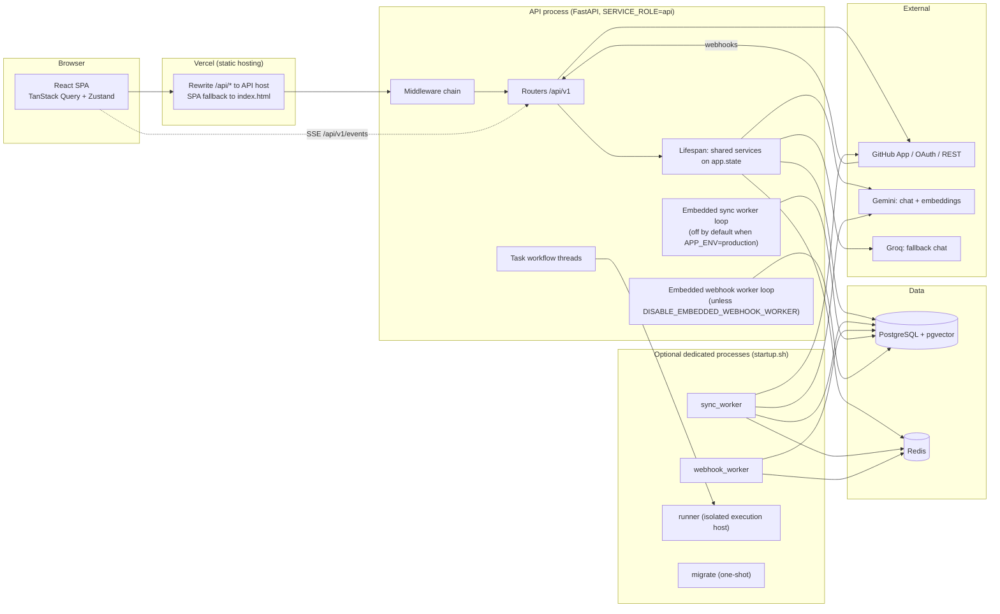
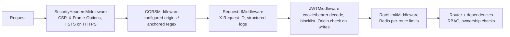
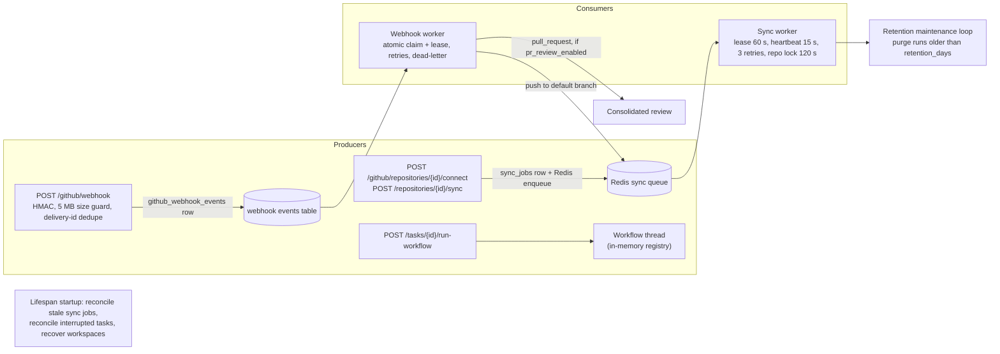

# System Architecture

## 1. Context

The API process serves HTTP and also hosts the webhook worker loop and task-workflow threads. The embedded sync worker loop runs in development and is **disabled by default in production** (the settings validator sets `DISABLE_EMBEDDED_SYNC_WORKER=true` unless it is set explicitly), so production needs either a dedicated `sync_worker` process or an explicit `DISABLE_EMBEDDED_SYNC_WORKER=false`. Roles are selected with `SERVICE_ROLE` (see [Deployment guide](../07-deployment/DEPLOYMENT_GUIDE.md)).

## 2. Request pipeline

Middleware is registered so that the outermost layer runs first:

Errors are returned as an envelope `{code, message, retryable, request_id}` (`app/core/errors.py`).

## 3. Main subsystems

| Subsystem | Responsibility | Primary code |
|---|---|---|
| API layer | HTTP contracts, auth, RBAC, tenant isolation | `backend/app/api/v1` |
| Services | Orchestrators for analysis, tasks, sync, webhooks, history, publication | `backend/app/services` |
| Data access | Repository classes / aggregates over SQLAlchemy models | `backend/app/repositories`, `backend/app/models` |
| AI | LLM gateway, embeddings, retrieval, context, prompts, agents, verifiers | `backend/ai` |
| Scanner and indexer | Parsing, symbols, graphs, framework detection, rules, chunking, incremental indexing | `backend/scanner`, `backend/indexer` |
| Tools and sandbox | Tool registry/router/policy; workspaces, command runner, backends, test runner, diff verification | `backend/agent/tools`, `backend/sandbox`, `backend/runner` |
| Frontend | Studios for chat/explain/bugs/tests/review/tasks, task pages, admin page | `frontend/src` |

Details: [Backend](BACKEND_ARCHITECTURE.md) · [Frontend](FRONTEND_ARCHITECTURE.md) · [AI and RAG](AI_AND_RAG_ARCHITECTURE.md) · [Database](DATABASE_ARCHITECTURE.md) · [Agent execution](AGENT_EXECUTION_ARCHITECTURE.md).

## 4. Background processing

## 5. Real-time events

`GET /api/v1/events` is an SSE endpoint backed by Redis Streams with `Last-Event-ID` resume. Events are published to a per-user channel (`events:user:{user_id}`). The repositories list consumes sync progress through `useRealtimeRepositories`; task pages poll task and event endpoints.

## 6. Deployment topology (reference)

| Component | Where it runs | Notes |
|---|---|---|
| SPA | Vercel | `vercel.json` rewrites `/api/*` to the API host and sets security headers incl. CSP |
| API | Azure Web App (Python runtime) | CI jobs `build-and-package` → `deploy` upload the source tree as an artifact and zip-deploy it on pushes to `main`; `post-deployment-verification` probes it. The multi-stage `Dockerfile` is used for container deployments and `docker-compose.yml` |
| Workers | Same image with `SERVICE_ROLE=sync_worker` / `webhook_worker` | Not deployed by CI; embedded loops run in the API unless disabled |
| Runner | Dedicated Linux host with Docker (+ gVisor when available) | `scripts/setup_runner_host.sh`; required for isolated execution in production |
| PostgreSQL / Redis | Managed services (e.g. Supabase, Upstash/Azure) or compose | |
