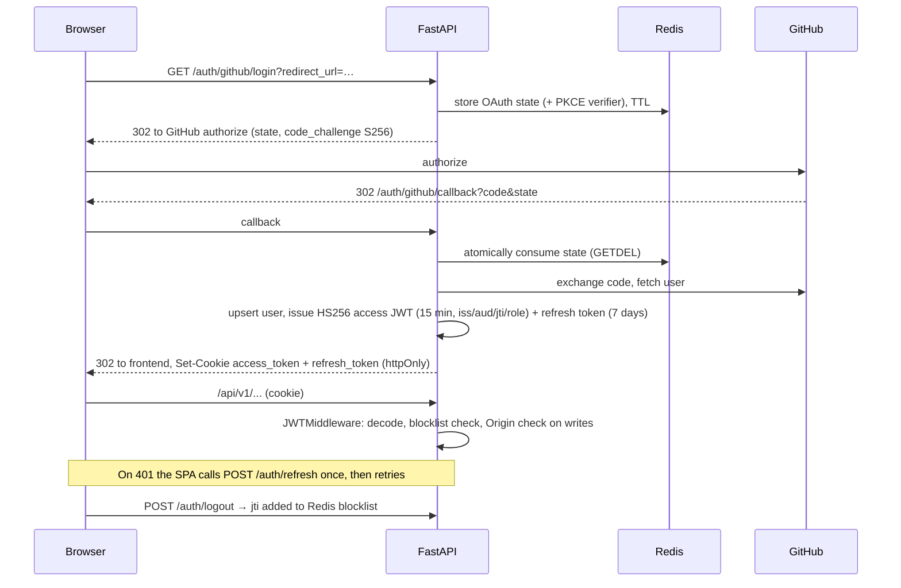
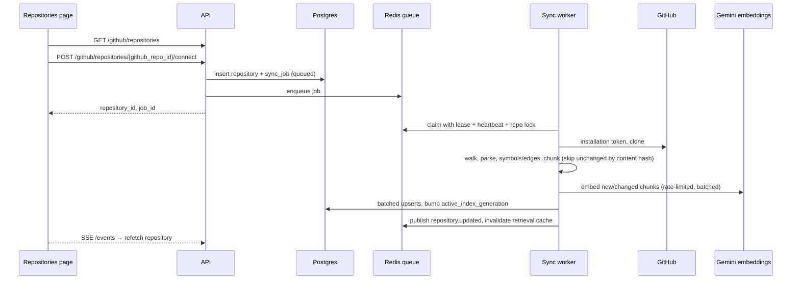
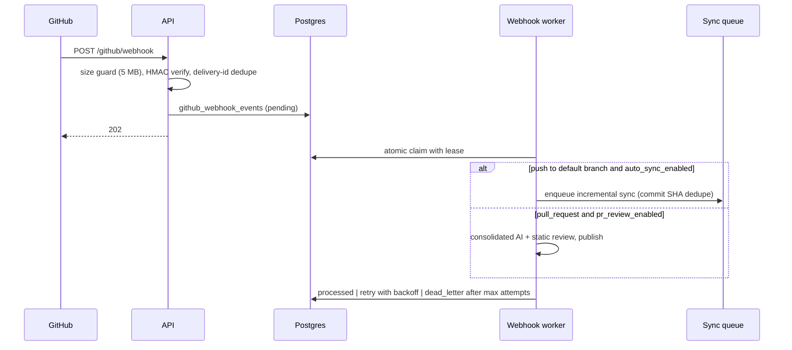

# Data Flows

## 1. Authentication (GitHub OAuth)

If Redis is unavailable during state handling or blocklist checks, auth fails closed with `503`.

## 2. Connect and index a repository

## 3. Ask a question

`RepositoryChat` → `useRepositoryChat` (history in React state) → `POST /repositories/{id}/chat {question, history, mode}` → ownership check → project memory lookup → `RAGPipeline.chat` (normal) or `AgentOrchestrator` (agentic) → `RepositoryAnswer` validated and redacted → response with citations. The final answer is also published once to the user's SSE stream.

## 4. Run an analysis

Studio page → `useAnalysis` → `POST /repositories/{id}/{explain|detect-bugs|generate-tests|review}` (long AI timeout) → orchestrator (target resolution → context → deterministic analysis → LLM → validation) → `analysis_runs` + `analysis_findings` → response → history drawer via `/analysis-runs`.

## 5. Webhook automation

Dead-letter events can be replayed with `POST /github/events/{id}/replay`.

## 6. Task to draft PR

See [Agent execution architecture](../02-architecture/AGENT_EXECUTION_ARCHITECTURE.md). Every step writes `task_events`; tool calls write `tool_invocations`; tests write `test_runs`; repairs write `repair_attempts`; verification writes `verification_results`; publication writes `task_pull_requests`. `GET /tasks/{id}/traceability` returns the chain from the originating finding/issue to the draft PR.
