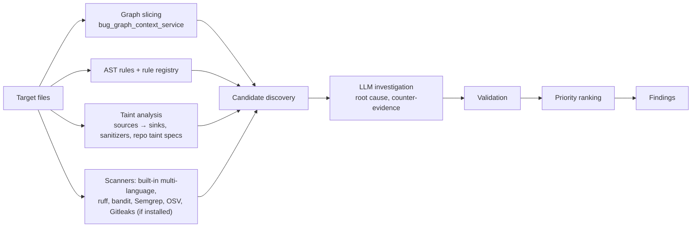

# Developer Intelligence Features

Four analysis features share one request/response contract (`app/schemas/analysis.py`), one persistence model (`analysis_runs` + `analysis_findings`) and one context layer (`ai/context`). Each is exposed as `POST /api/v1/repositories/{id}/{explain|detect-bugs|generate-tests|review}`.

## Shared pipeline

```mermaid
flowchart LR
  REQ["Request<br/>target file / symbol / line range / diff"] --> OWN["Ownership + RBAC"]
  OWN --> TGT["Target resolution<br/>indexed file or GitHub source at a pinned revision"]
  TGT --> SYM["Symbol resolution<br/>target_selector, source_location"]
  SYM --> CTX["Feature context builder<br/>within CONTEXT_BUDGET_*"]
  CTX --> DET["Deterministic analysis<br/>(feature-specific)"]
  DET --> LLM["LLMGateway<br/>schema-constrained output"]
  LLM --> VAL["Validation, grounding,<br/>deduplication, redaction"]
  VAL --> PERS["analysis_runs + analysis_findings<br/>prompt version + model recorded"]
  PERS --> RESP["Response + history entry"]
```

## Code explanation

Follow-up chat drafts include the file analyzed by the explanation, even after opening a citation in another file.

- Targets: file, symbol or line range; detail levels summary / detailed / deep (one call-graph level).
- Context: enclosing symbol, callers/callees, related files (imports, edges, PageRank, co-change), framework conventions.
- Output: overview, step-by-step walkthrough, inputs/outputs, edge cases, example flows, citations.
- Related files: `GET /repositories/{id}/explain/related-files`.

## Bug detection

- Findings can be turned into GitHub issues (`POST /repositories/{id}/issues`) or tasks.
- Scanner availability is reported with results; missing binaries do not fail the run.

## Test generation

The proposed path is marked new only after checking the complete indexed file list. On a partial list, a missing path is shown as unverified.

- Framework detection: pytest, unittest, Jest, Vitest (plus conventions such as test paths and fixtures).
- Requirement discovery and gap analysis select what to test; generated tests are syntax-checked and path-checked (no writes outside allowed test paths).
- Execution verification (when a sandbox backend is available): build → run → **3 consecutive passing runs** (stability) → coverage delta attribution → optional mutation scoring. Tests that cannot be executed are marked unverified rather than passed.
- Coverage-guided iteration feeds uncovered lines back for another generation round within budget.

## Code review

The studio reviews the entire selected file, including when a symbol or line range is highlighted.

- Inputs: file, commit, pull request (by number) or raw diff.
- Static review: ruff, bandit, eslint, biome — batched per scanner, executed concurrently.
- AI review across correctness, security, performance, reliability and maintainability; source mapping attributes findings to changed lines.
- Quality gate: findings must cite valid in-diff lines; multi-stage deduplication; lifecycle tracking across commits; incremental review of new commits.
- Publication: `POST /repositories/{id}/review/publish` posts a single GitHub review with inline comments (opt-in, idempotent per click).
- Feedback: `POST /analysis-runs/{run_id}/findings/{finding_id}/feedback` (thumbs up/down) feeds evaluation.
- Repository settings: `GET/PATCH /repositories/{id}/review/settings`.

## History and evaluation export

- `GET /repositories/{id}/analysis-runs` (filters, pagination), `/summary` (integrity and retention metrics), `/export` (JSONL dataset including user feedback), `GET /analysis-runs/{run_id}`.
- Database errors return `503`; there is no in-memory fallback.
- Runs older than `RETENTION_DAYS` are purged by the maintenance loop.

## Prompt templates

| Template | Used by |
|---|---|
| `explanation_system.txt` | Explanation |
| `bug_detection_system.txt` | Bug detection |
| `test_generation_system.txt`, `test_planning_system.txt`, `test_review_system.txt` | Test generation |
| `code_review_system.txt` | Code review |
| `chat_system.txt`, `repository_chat.txt`, `grounding_system.txt`, `source_grounding.txt` | Chat and grounding |
| `repair_system.txt`, `repair_code_system.txt` | JSON repair / code repair |
| `summary_system.txt`, `context_summary.txt` | Summaries |
