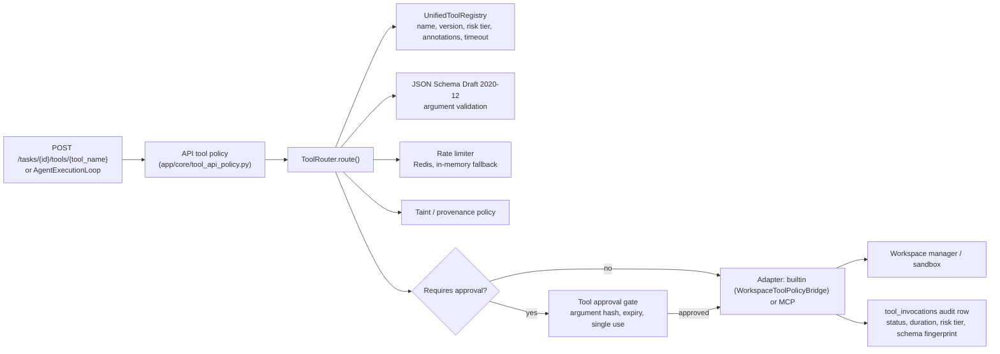

# Tool Registry and Tool Router

Two tool systems exist with different purposes:

| System | Location | Used by | Tools |
|---|---|---|---|
| Chat agent tools | `backend/ai/agent/tools` | Agentic repository chat | Read-only: `search_code`, `read_file_range`, `get_symbol`, `find_callers` |
| Unified workspace tool registry | `backend/agent/tools` + `backend/sandbox/tool_policy_bridge.py` | Task execution | 19 workspace tools (below) plus MCP adapter |

## Architecture

## Workspace tools

| Tool | Purpose |
|---|---|
| `read_file`, `list_files` | Read within the workspace (path guard) |
| `write_file`, `patch_file`, `delete_file` | Modify files (scope and forbidden-path checks) |
| `execute_command` | Allow-listed command templates only, argument safety validation |
| `run_tests` | Restricted test runner |
| `inspect_git_diff`, `validate_task_diff`, `verify_diff_immutability` | Diff inspection and validation |
| `check_disk_budget`, `check_stale_revision`, `validate_workspace_invariants` | Guardrails |
| `record_repair_attempt`, `recover_workspace`, `cleanup_orphaned_workspaces` | Repair and recovery bookkeeping |
| `commit_task_changes`, `push_task_branch`, `create_draft_pr` | Publication (critical risk tier; push/PR additionally require publication authorisation) |

Each tool declares a risk tier, timeout, annotations (e.g. destructive hint) and a rate limit (e.g. publication tools: 5 requests / 60 s per task).

## Status values

`tool_invocations.status`: `ALLOWED`, `BLOCKED`, `COMPLETED`, `FAILED`, `TIMEOUT`, `RATE_LIMITED`.

## MCP integration

- `agent/tools/adapters/mcp.py` forwards tool calls to the in-process `PlatformMCPServer` JSON-RPC dispatcher (`app/mcp/server.py`).
- MCP elicitations (`/tasks/{id}/mcp/elicitations/*`) pause execution until the user responds.
- The admin registry (`/api/v1/mcp/servers`) is in-memory: listing requires `developer`, mutations require `admin`; URLs are validated against SSRF (DNS resolution, private/metadata IPs blocked) and stdio commands reject shell metacharacters.

## Adding a tool

1. Define the JSON Schema for arguments and register the tool with name, version, risk tier, timeout and rate limit.
2. Implement the handler in the builtin adapter (workspace operations must go through `WorkspaceManager` and `path_guard`).
3. Decide whether the tool requires approval (risk tier `write-external` or higher).
4. Add tests for schema rejection, policy denial, rate limiting and audit persistence.
