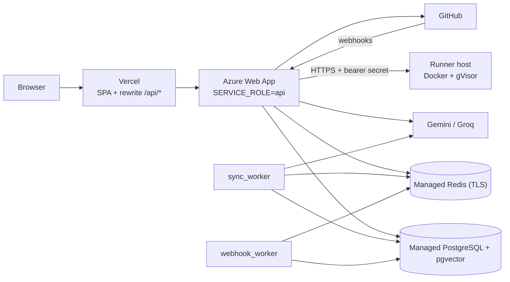

# Deployment Guide

## Reference topology



## 1. Database

1. Provision PostgreSQL 15+ with the `vector` extension (`CREATE EXTENSION IF NOT EXISTS vector;`). Managed hosts that match `supabase.co`/`.com` get `sslmode=require` automatically.
2. Set `DATABASE_URL` (`postgresql+psycopg://…`).
3. Run migrations once per release: `SERVICE_ROLE=migrate ./startup.sh` (or `alembic -c backend/alembic.ini upgrade head`). Set `RUN_MIGRATIONS_ON_STARTUP=false` on long-running roles when migrations are run as a release step.
4. Never run `backend/scripts/seed_database.py` against a non-local database.

## 2. Redis

Provision Redis 7 (TLS `rediss://` for managed services). Size `REDIS_MAX_CONNECTIONS` (default 50) to the provider's connection limit divided by the number of processes.

## 3. API (Azure Web App)

1. Configure application settings from [Environment configuration](ENVIRONMENT_CONFIGURATION.md) with `APP_ENV=production`, `COOKIE_SECURE=true`, `CORS_ALLOWED_ORIGINS=https://<spa-domain>`, `FRONTEND_URL=https://<spa-domain>`, `GITHUB_OAUTH_REDIRECT_URI=https://<api-or-spa-domain>/api/v1/auth/github/callback`, `WEBSITES_PORT=8000`.
2. Health check path: `/api/v1/health/ready`.
3. CI (`.github/workflows/main_ai-powered-dev-platform-api.yml`) on push to `main`: lint/static → backend tests → frontend lint/types → frontend tests/build → migration validation → security scan → `build-and-package` → `deploy` (OIDC login, `azure/webapps-deploy`) → `post-deployment-verification` (polls health and `/docs`).
4. For an embedded sync worker, set `DISABLE_EMBEDDED_SYNC_WORKER=false` on the API. For a dedicated Azure worker, run **Deploy Sync Worker to Azure Web App** with the successful `main` API release run ID. Use `bash startup.sh` as the worker's startup command. Once the workflow confirms the worker's Redis heartbeat, set `DISABLE_EMBEDDED_SYNC_WORKER=true` on the API.

## 4. Workers (container platforms)

Use the same image with different roles:

```bash
docker run -e SERVICE_ROLE=sync_worker    <image>
docker run -e SERVICE_ROLE=webhook_worker <image>   # then DISABLE_EMBEDDED_WEBHOOK_WORKER=true on the API
```

`docker-compose.yml` shows the reference wiring (`postgres`, `redis`, `api`, `sync_worker`).

## 5. Runner host (isolated execution)

1. Provision an Ubuntu 24.04 host and run `scripts/setup_runner_host.sh` (Docker CE, gVisor, daemon configuration, pinned sandbox images).
2. Start `SERVICE_ROLE=runner` with `RUNNER_AUTH_SECRET`. Mount a private writable workspace share on the API and runner at the same absolute path. Set `TASK_WORKSPACE_ROOT` to that path on both hosts.
3. On the API, set `SANDBOX_BACKEND=runner`, `RUNNER_BASE_URL`, and the matching `RUNNER_AUTH_SECRET`. Check that API readiness reports `operations.sandbox_backend_ok=true`, then run a task against a test repository to confirm both hosts see the same checkout.
4. Without a runner (or Docker on the API host) task tests, repair verification and execution-verified test generation cannot run in production.

## 6. Frontend (Vercel)

1. Use the repository root with the root `vercel.json` (`cd frontend && npm ci && npm run build`, output `frontend/dist`, SPA fallback, `/api/*` rewrite, security headers and CSP).
2. Update the rewrite destination in `vercel.json` to your API host.
3. Build-time variables: `VITE_API_BASE_URL=/api/v1` (to use the rewrite), `VITE_GITHUB_APP_SLUG`, `VITE_ENABLE_MSW=false`.

## 7. GitHub App (production)

Callback: `https://<domain>/api/v1/auth/github/callback`. Webhook: `https://<api-domain>/api/v1/github/webhook` with `GITHUB_WEBHOOK_SECRET`. Permissions and events as in [Development setup](../06-development/DEVELOPMENT_SETUP.md#3-register-a-github-app).

## 8. Post-deployment verification

```bash
curl -fsS  "$API_URL/api/v1/health/live"
curl -fsS  "$API_URL/api/v1/health/ready"
curl -fsSI "$API_URL/docs"
curl -fsSI "$APP_URL"
```

Then sign in through GitHub, confirm `GET /api/v1/auth/me` returns 200, connect a small repository and watch sync progress over `/api/v1/events`.

## 9. Rollback

- API: redeploy the previous green workflow run or swap deployment slots.
- Database: prefer forward-fix migrations; take a point-in-time snapshot before any `alembic downgrade`.
- Frontend: Vercel instant rollback to the previous production deployment.

## 10. Troubleshooting

| Symptom | Cause / fix |
|---|---|
| `startup.sh: syntax error near unexpected token` | CRLF line endings; `.gitattributes` enforces LF for `*.sh` |
| Health probe fails on Azure | `WEBSITES_PORT` does not match the app port |
| Startup "Production configuration error" | A production rule in [Environment configuration](ENVIRONMENT_CONFIGURATION.md) is violated |
| Repositories never index | No sync worker running in production |
| `RunnerUnavailableError` | Runner host down or secret mismatch; no fallback by design |

Operational procedures: [Runbooks](RUNBOOKS.md).
