# 02 — System Architecture

All diagrams describe the **current, discovered** architecture unless the heading says **PROPOSED**. Issue references point to 01.

---

## 1. Overall system architecture (current)

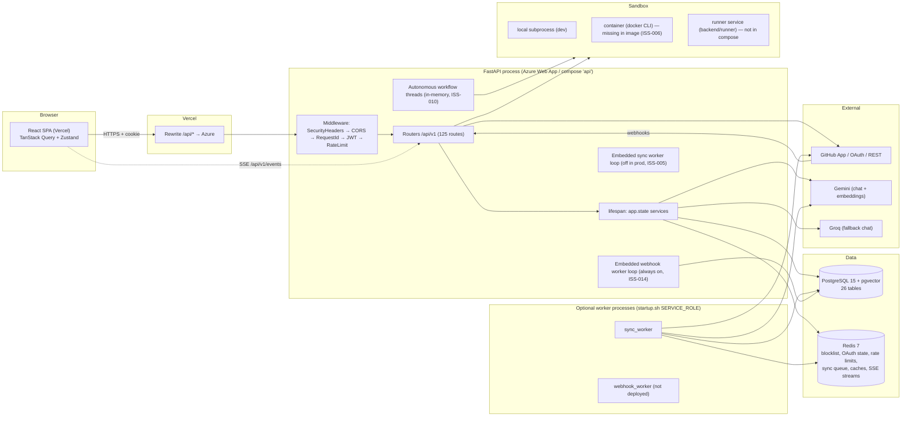

**Observations.** The API process is also a worker host (webhook loop always, sync loop in dev, workflow threads). In production the sync loop is forced off (ISS-005) and no separate worker is deployed by the pipeline; the container sandbox cannot work in the image (ISS-006).

---

## 2. Frontend architecture and frontend ↔ backend communication

| Concern | Implementation | Notes |
|---|---|---|
| Routing | `frontend/src/App.tsx` — `/login`, `/auth/callback`, `/app/{dashboard,repositories,tasks,tasks/new,tasks/:taskId,tools}`, `/app/repositories/:id/{(index),chat,explain,bugs,tests,review,tasks}` | All pages lazy-loaded; `ProtectedRoute` gates `/app` |
| Server state | TanStack Query hooks in `src/hooks/*` (`useRepositories`, `useTasks` 567 LOC, `useAnalysis`, `useRepositoryChat`, `useStudioFile`, …) | Polling via `refetchInterval` for repos and tasks |
| Client state | Zustand: `useAuthStore` (user), `useAppStore` (sidebar) | Minimal, appropriate |
| HTTP | `src/services/api.ts` Axios: `withCredentials`, 30 s default, 180 s for URLs containing `/explain`, `/chat`, `/tests`, … | Substring matching also hits non-AI GETs (`/tasks/{id}/tests`) — OPT-02 |
| Auth | Cookie (httpOnly) set by backend; 401 → hard redirect to `/login?redirect=…` | No refresh (ISS-012) |
| Realtime | `src/realtime/index.ts` EventSource to `/api/v1/events` with Last-Event-ID and backoff; consumed only by `useRealtimeRepositories` (repo sync progress) | Tasks/chat do not use SSE |
| Types | Hand-written `src/types/{api,analysis,task,memory}.ts` (2,171 LOC) | Drift from backend (ISS-017) |
| Mocks | `src/lib/msw/*` (custom MSW clone) + `src/mocks/handlers/*` (4,319 LOC), enabled only with `VITE_ENABLE_MSW=true` in dev | DC-19 |

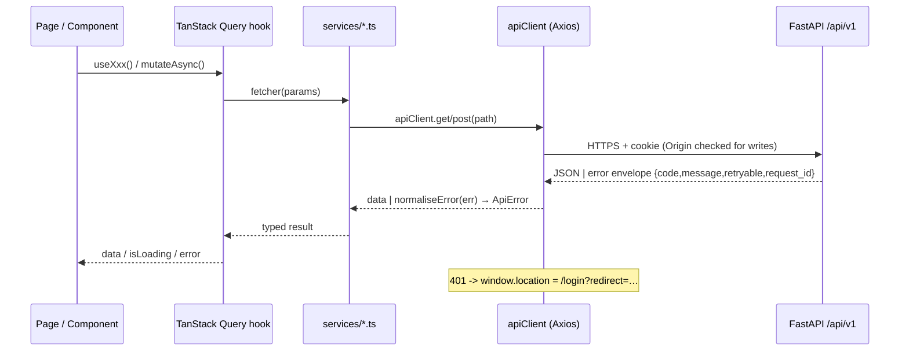

---

## 3. Backend service architecture

```mermaid
flowchart TB
  subgraph HTTP["app/api/v1"]
    AUTH[auth.py]
    REPO[repositories.py]
    CHAT[chat.py]
    AN["analysis/{explain,bugs,tests,review,history}.py"]
    GHR["github.py + integrations/github/routes.py (/source/*)"]
    ISSUES[issues.py]
    MEM[memories.py]
    TASKS["tasks.py (2,121 LOC, 47 routes)"]
    EVT["events.py (SSE)"]
    MCP["mcp_registry.py (in-memory, ISS-003)"]
  end
  subgraph Services["app/services"]
    EXO[explanation_orchestrator]
    BDO[bug_detection_orchestrator]
    TGO[test_generation_orchestrator]
    CRO[code_review_orchestrator]
    TEO["task_execution_orchestrator (2,458 LOC)"]
    HIST["*_history_service, analysis_run_history_service"]
    SYNC["sync_worker / repository_sync"]
    WH["webhook_worker / webhook_handlers"]
    SSE[sse_redis_streams]
    GITB["git_branch (pr-metadata → pull_requests, ISS-042)"]
    MEMS[memory_service]
  end
  subgraph Repos["app/repositories (data access)"]
    RR[RepositoryRepository]
    TR["TaskRepository (task/* mixins)"]
    AR["analysis/* mixins"]
    OTHER["chunk, symbol, edge, memory, webhook_event, installation, user"]
  end
  subgraph AI["backend/ai"]
    LLMGW[llm.client.LLMGateway]
    RAG[pipeline.RAGPipeline]
    AGENT[agent.AgentOrchestrator]
    CTX["context/* builders"]
    AISVC["services/* (planner, repair, synthesizers, verifiers, engines)"]
    WF["workflows/autonomous_task_workflow (threads)"]
  end
  SBX["sandbox/* (workspace_manager, command_runner, backends)"]
  AGT["agent/tools (ToolRouter, registry, policy)"]
  SCN["scanner/*, review/static_reviewer"]
  IDX["indexer/*"]
  AN --> EXO & BDO & TGO & CRO
  EXO & BDO & TGO & CRO --> CTX & AISVC & LLMGW & HIST
  CRO --> SCN
  BDO --> SCN
  CHAT --> RAG & AGENT
  TASKS --> TEO & WF & AISVC
  TEO --> SBX & AGT & AISVC & MEMS
  GHR --> GITB
  SYNC --> IDX & SCN
  HTTP --> Repos
  Services --> Repos
```

**Dependency injection pattern.** Long-lived services are created in `app/core/lifespan.py` and read with `getattr(request.app.state, "...", None)`, with lazy construction fallbacks in several routes (e.g., `chat.py` builds an `AgentOrchestrator` if none exists). Four `app.state` services are created but never read (ISS-039). Recommendation: typed accessor functions (`get_llm_gateway(request) -> LLMGateway`) used through `Depends`, which also simplifies test overrides and removes test sniffing (ISS-041).

**Layering health.** Routers mostly delegate to services/repositories, but `tasks.py` (2,121 LOC) and `github.py` contain substantial logic (serialization, fallbacks, inline imports). `task_execution_orchestrator.py` (2,458 LOC) and `workspace_manager.py` (2,138 LOC) are god-objects — see OPT-06.

---

## 4. AI / LLM architecture

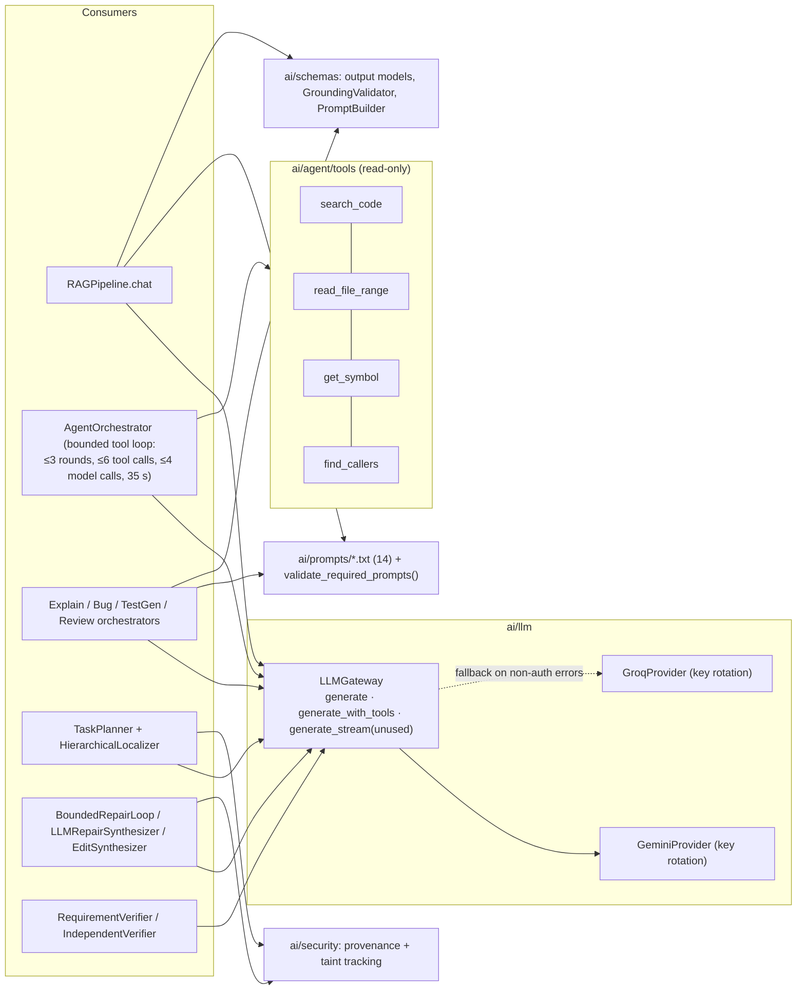

| Capability | Status |
|---|---|
| Provider selection / fallback | Implemented (`lifespan.init_llm_gateway`; no fallback on auth errors by default) |
| Retry | Provider-level retries (`ai_max_retries=3`) + fallback |
| Concurrency / rate control | **Missing** for chat LLM calls (ISS-025); present for embeddings |
| Streaming | Implemented in gateway, **unused**; simulated over SSE (ISS-015) |
| Tool calling | Implemented for chat agent (Gemini & Groq normalized); task tools go through `agent/tools/ToolRouter` |
| Output validation | Pydantic schemas + `GroundingValidator` (citations checked against retrieved chunks / DB) |
| Context/token management | `ai/context/token_budget.py` (tiktoken), per-feature budgets `context_budget_*` |
| Cost tracking | `app/core/telemetry.py` stage metrics + static price table (Gemini Flash prices hard-coded — verify current pricing before relying on cost numbers) |
| Prompt management | Plain-text files loaded at runtime; no versioning in DB; prompts not hashed into run records (OPT-18) |
| Memory | Pipeline supports it; never supplied (ISS-036) |
| Conversation history | Client-supplied only (ISS-016) |

---

## 5. RAG pipeline (current)

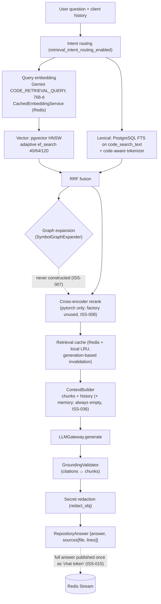

Indexing side (sync worker): `scanner.walker` → `scanner.parser` (tree-sitter) → symbols/edges (`code_symbols`, `symbol_edges`, PageRank-style `importance_score`) → `indexer.chunker` (symbol-aware) → `indexer.incremental` (content-hash skip, `active_index_generation`) → Gemini document embeddings (rate-limited) → `code_chunks` (HNSW index `ix_code_chunks_embedding_hnsw`, FTS on `code_search_text`).

---

## 6. Database architecture

**Technology:** PostgreSQL + pgvector; SQLAlchemy 2 declarative models (`app/models`), Alembic with a single linear chain of 18 revisions (`24498ac67b3e` → … → `k8b9c0d1e2f3`). All 26 model tables are created by migrations (every table has a matching `op.drop_table` in a downgrade). Column-level parity could **not** be verified without a live DB — run `alembic upgrade head && alembic check` in CI (TST-25).

### 6.1 ER diagram (current; key columns only)

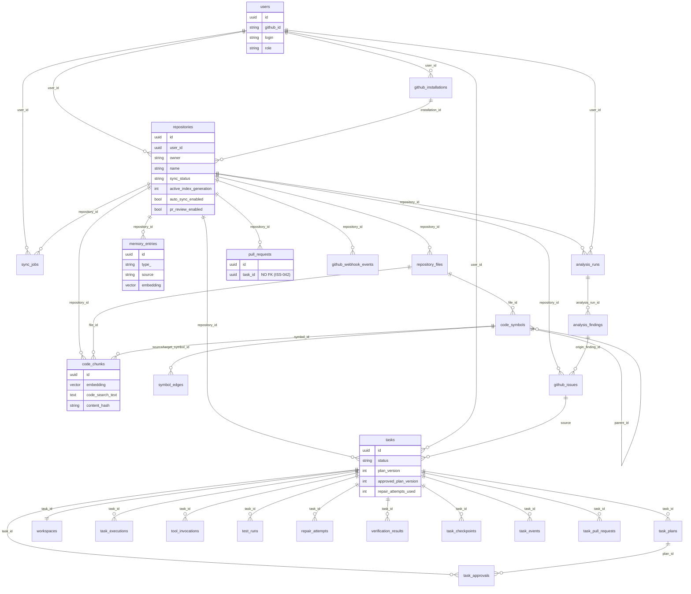

### 6.2 Observations

| Topic | Finding | Ref |
|---|---|---|
| Duplicate structures | `pull_requests` vs `task_pull_requests` | ISS-042 |
| Missing relationships | `pull_requests.task_id` no FK; user FKs without `ondelete` | ISS-042, ISS-034 |
| Missing tables for features | chat sessions/messages; MCP servers/tool policies; durable workflow jobs | ISS-016, ISS-003, ISS-010 |
| Indexes | HNSW on `code_chunks.embedding` and `memory_entries.embedding`; `(repository_id, content_hash)`; 112 `index=True`/`Index(` declarations. Repository listing lacks `(user_id, created_at)` for pagination (ISS-024) | OPT-20 |
| Transactions | Sync sessions per request (`get_db`); long LLM awaits happen while a session is open in several async handlers | ISS-009 |
| Connection management | Two engines per process | ISS-032 |
| Data lifecycle | `AnalysisRunHistoryService.purge_expired_runs(retention_days=30)` (`app/services/analysis_run_history_service.py` L239) and `app/repositories/analysis/retention.py` exist, but **nothing calls the purge** (no route, worker or scheduler) — Verified (static). `analysis_runs.result_payload`, `task_events`, `tool_invocations`, `github_webhook_events` grow without bound. Workspace cleanup via `workspaces.cleanup_at` + startup recovery | OPT-21 |
| Bypass of migrations | `scripts/seed_database.py` uses `drop_all/create_all` | ISS-029 |

---

## 7. Authentication workflow (current)

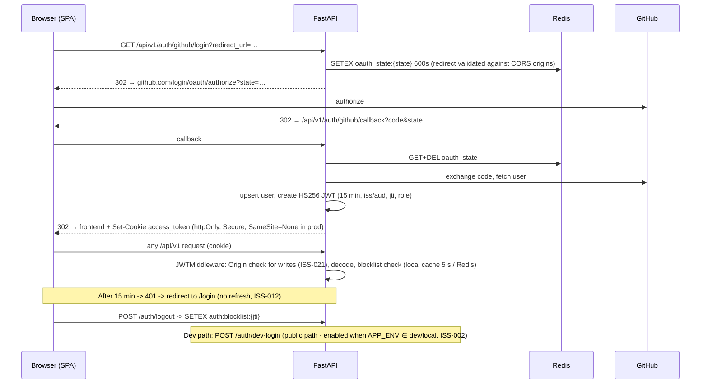

Authorization: role claim (`viewer < developer < admin`) via `require_min_role`/`require_role`; tenant isolation via `get_owned_repository` / `get_owned_task` / `_request_user_id` lookups in every router except `mcp_registry.py` (ISS-003) and the public webhook (HMAC-verified).

---

## 8. Major user workflows (actual data flow)

### 8.1 Connect and index a repository

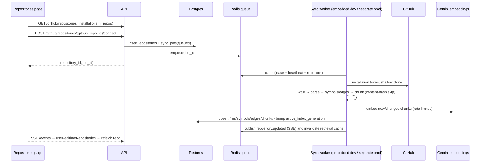
Break points: no worker in production (ISS-005); global SSE fan-out (ISS-020).

### 8.2 Ask a question (chat)
`RepositoryChat.tsx` → `useRepositoryChat` (history in React state) → `services/chat.ts` `POST /repositories/{id}/chat {question, history, mode}` → ownership check → `RAGPipeline.chat` or `AgentOrchestrator.run` → `RepositoryAnswer` (redacted) → render with citations; full answer also published to Redis Stream as one "token". Break points: ISS-007/008 (retrieval quality), ISS-015, ISS-016, ISS-036.

### 8.3 Explain / Bugs / Tests / Review
Studio page → `useAnalysis` hook → `POST /repositories/{id}/{explain|detect-bugs|generate-tests|review}` (180 s timeout) → orchestrator: resolve target (DB file / GitHub source service) → context builder (budgeted) → static scanners (bugs/review; absent in prod image, ISS-013) → LLM → schema validation → persist `analysis_runs` + `analysis_findings` (+ in-memory copy, ISS-038) → response → `AnalysisHistoryDrawer` via `/analysis-runs`. Review can publish to GitHub (`/review/publish`) and bugs can create issues (`/issues`).

### 8.4 Agent task lifecycle

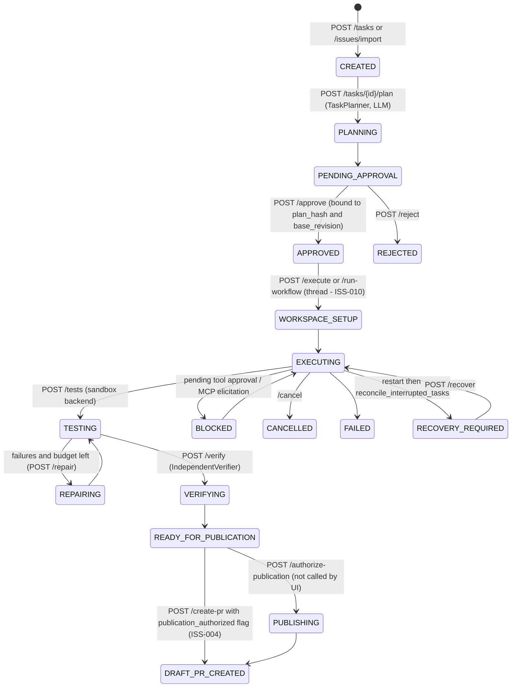
Statuses are the `TaskStatus` values in `backend/app/models/task.py`. Pause/resume (`/pause`, `/resume`) act on the execution/workspace state rather than adding a `TaskStatus` value; the exact transitions should be confirmed against `app/repositories/task/core.py` before relying on this diagram for implementation.
Approvals for risky tools (`/tool-approvals/*`) and MCP elicitations (`/mcp/elicitations/*`) can block execution until a human responds (`ApprovalHistoryPanel`). The UI polls `/tasks/{id}` and `/tasks/{id}/events` rather than using SSE.

---

## 9. Background job processing (current)

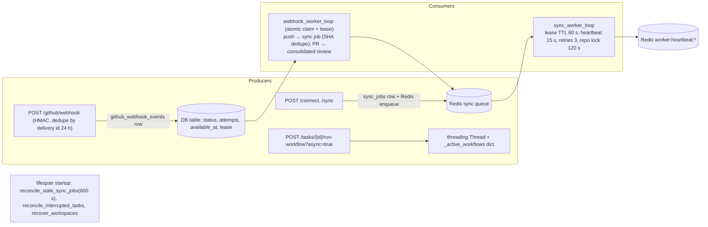

---

## 10. Inter-module dependencies (import-graph facts)

- Reachability from `app.main`, `app.workers.*`, `migrations.env`: almost every module is reachable, frequently only through package `__init__` re-exports, which hides dead code. Modules whose **only** production importer is their own package `__init__` are listed in 05 §2.2.
- Two tool systems: `ai/agent/*` (chat agent, read-only tools) and `agent/tools/*` (task tool router with policy, rate limiting, MCP/plugin adapters). They share concepts (schemas, risk tiers) but not code (DC-16).
- Two GitHub access layers with overlapping methods: `GitHubService` (`list_issues`, `get_issue`, `create_task_branch`, `push_branch`) and `GitHubSourceService` (`list_issues`, `get_issue`, `setup_task_branch`) (DC-17). Push also happens via git CLI in `WorkspaceManager.push_task_branch` (three push paths).
- Two `RAGPipeline` classes (`ai/pipeline.py` canonical; `ai/retrieval/pipeline.py` test facade) (DC-02).
- `app/core/telemetry.py` (stage metrics/cost) vs `app/observability/telemetry.py` (OTel) — different responsibilities, confusing names (DC-27 rename only).

---

## 11. PROPOSED optimized architecture

> **PROPOSED** — keeps the existing stack (FastAPI, Postgres/pgvector, Redis, React). No new infrastructure technology is introduced; DBOS is optional (see 06 OPT-08).

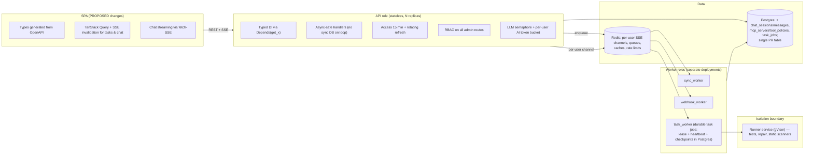

Key differences from current: (1) no work executed inside API processes except request handling; (2) every long-running job durable in Postgres and leased via Redis; (3) scanners and untrusted code only in the runner; (4) per-user event channels; (5) contracts generated from OpenAPI; (6) single PR model; (7) memory wired into prompts with provenance separation.
