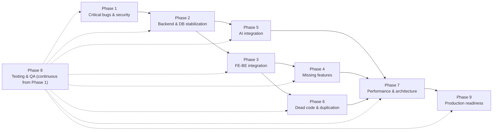

# 10 — Implementation Roadmap

Task IDs: `T<phase>.<n>`. Each task lists priority, linked issues/features/DC/OPT/DEP/TST IDs, files, dependencies (other tasks), and acceptance. Complexity: S ≤ ½ d · M 1–3 d · L 3–8 d · XL > 8 d. Phases are ordered; tasks inside a phase can run in parallel unless a dependency is listed.

(Phase 8 runs continuously from Phase 1; each task carries its own tests.)

---

## Phase 1 — Critical bugs and security

**Objective:** Remove the authentication bypasses and confirm the production core loop actually runs.

| Task | Pri | Description | Links | Files | Depends | Cx | Acceptance |
|---|---|---|---|---|---|---|---|
| T1.1 | P0 | Fail-closed JWT secret in compose; strengthen validator; blank placeholders; rotate production secret | ISS-001, DEP-11, TST-01 | `docker-compose.yml`, `backend/app/core/config.py`, `.env*.example` | — | S | Compose refuses to start without secret; validator rejects all committed placeholders |
| T1.2 | P0 | Gate dev-login behind `ENABLE_DEV_LOGIN` + loopback; remove first-user fallback and hard-coded login; 404 when disabled | ISS-002, ISS-037, DEP-12, TST-02 | `backend/app/api/v1/auth.py`, `backend/app/core/auth.py` (`PUBLIC_PATHS`), `backend/app/core/config.py`, `frontend/src/pages/Login.tsx`, `frontend/src/services/auth.ts` | — | S | Default settings → 404 |
| T1.3 | P0 | RBAC on MCP registry (admin for mutations, developer for reads) as an immediate guard | ISS-003, TST-04 | `backend/app/api/v1/mcp_registry.py` | — | S | viewer/developer mutations → 403 |
| T1.4 | P0 | **Verify** production worker topology in Azure; if absent, deploy a `sync_worker` (and `webhook_worker`) role or set `DISABLE_EMBEDDED_SYNC_WORKER=false` for single-instance | ISS-005, ISS-014, DEP-13 | `.github/workflows/main_ai-powered-dev-platform-api.yml`, `startup.sh`, `backend/app/core/config.py` (add `disable_embedded_webhook_worker`), `Docs/deployment/cloud_deployment_guide.md` | — | S–M | Fixture repo indexes end-to-end in production; readiness shows worker heartbeat |
| T1.5 | P1 | Make publication require persisted SHA-bound authorization; FE calls authorize then create-pr | ISS-004, TST-20, TST-E3 | `backend/app/api/v1/tasks.py`, `backend/app/services/task_execution_orchestrator.py`, `backend/app/repositories/task/publication.py`, `frontend/src/components/tasks/PublicationPanel.tsx`, `frontend/src/services/tasks.ts`, `frontend/src/hooks/useTasks.ts` | — | M | No PR without authorization record matching head SHA |
| T1.6 | P1 | Remove simulated push success outside explicit dev flag | ISS-018 | `task_execution_orchestrator.py` L1775–1885, `config.py` | — | S | Failed push in prod never `success=True` |
| T1.7 | P2 | CSRF `fullmatch` + anchored regex validation; `SameSite=Lax` default when behind rewrite; add CSP header | ISS-021, DEP-16, TST-05, TST-18 | `backend/app/core/auth.py`, `config.py`, `.env.production.example`, `vercel.json` | — | S | Tests pass |
| T1.8 | P2 | Git token via env, not argv | ISS-019, TST-06 | `backend/sandbox/workspace_manager.py` | — | S | No token in argv |
| T1.9 | P2 | Remove public automated-memory routes | ISS-023, TST-07 | `backend/app/api/v1/memories.py` | — | S | Routes absent |
| T1.10 | P2 | Guard seed script | ISS-029, TST-08 | `backend/scripts/seed_database.py` | — | S | Refuses non-local URL |

**Phase checklist:** ☐ T1.1 ☐ T1.2 ☐ T1.3 ☐ T1.4 ☐ T1.5 ☐ T1.6 ☐ T1.7 ☐ T1.8 ☐ T1.9 ☐ T1.10 ☐ secret rotated ☐ security tests TST-01…TST-08 green.

---

## Phase 2 — Backend and database stabilization

**Objective:** Correct wiring and contracts, remove event-loop blocking, unify dependencies and schema.

| Task | Pri | Description | Links | Files | Depends | Cx | Acceptance |
|---|---|---|---|---|---|---|---|
| T2.1 | P1 | Single Python manifest + lock; Docker/CI install from lock | ISS-026, DEP-01…08 | `pyproject.toml`, `requirements.txt`, `backend/requirements*.txt`, `Dockerfile`, workflows | — | M | `pip check` clean in image; one manifest |
| T2.2 | P1 | Fix graph-expander and reranker wiring; add settings-name static test | ISS-007, ISS-008, TST-27, TST-28 | `backend/app/core/lifespan.py`, `backend/ai/retrieval/reranker_factory.py` | — | S | Expander/reranker constructed per settings |
| T2.3 | P1 | Remove sync DB I/O from `async def` handlers (Option A) + AST guard test | ISS-009, OPT-05, TST-29 | 42 handlers (01 §3.1) | — | L | TST-29 = 0 offenders; TST-N1 target |
| T2.4 | P2 | Remove in-memory analysis-history fallback; surface persistence errors | ISS-038, TST-33 | `app/api/v1/analysis/history.py`, `app/services/explanation_orchestrator.py` (+ other orchestrators' `record_run` wrappers) | — | S | 503 on DB error |
| T2.5 | P2 | Consolidate PR tables (migration) and endpoints | ISS-042, DC-30, TST-26 | `app/models/{pull_request,task}.py`, new Alembic revision, `app/services/git_branch.py`, `app/integrations/github/routes.py`, `app/api/v1/tasks.py` | T1.5 | M | One table with FK |
| T2.6 | P3 | FK `ondelete` policies; align existing installation-deleted handler (`webhook_handlers.py` L253) with the policy | ISS-034 | models, new migration, `app/services/webhook_handlers.py` | — | S | Migration applied; uninstall leaves no orphan rows |
| T2.7 | P2 | Alembic `check` + up/down cycle in CI on PG+pgvector | OPT-23, TST-25 | `.github/workflows/postgres-persistence-ci.yml` | — | S | CI fails on drift |
| T2.8 | P2 | Pool sizing per role; drop unused engine per role | ISS-032, OPT-22 | `app/core/database.py`, `config.py`, env files | T1.4 | S | Budget documented; load test within limit |
| T2.9 | P2 | Replace silent `except` handlers (baseline + incremental) | ISS-040, OPT-09 | top files 01 §3.3 | — | M | Count ≤ 10 annotated |
| T2.10 | P2 | Remove test-aware branches via DI flags | ISS-041, OPT-10 | 14 files (01 ISS-041) | T3.4 | M | grep = 0 |
| T2.11 | P3 | Remove `ASYNC_DATABASE_URL`; fix README model names | ISS-027, ISS-028 | `docker-compose.yml`, `README.md` | — | S | — |
| T2.12 | P3 | Health router single mount | ISS-030 | `backend/app/main.py`, `app/api/v1/router.py` | — | S | Probes documented |
| T2.13 | P3 | Webhook Content-Length precheck | ISS-031, TST-10 | `app/api/v1/github.py` | — | S | 413 early |

**Checklist:** ☐ T2.1 … ☐ T2.13 ☐ OpenAPI diff reviewed ☐ migration tests green.

---

## Phase 3 — Frontend and backend integration

**Objective:** One contract source, correct data on every existing screen.

| Task | Pri | Description | Links | Files | Depends | Cx | Acceptance |
|---|---|---|---|---|---|---|---|
| T3.1 | P1 | OpenAPI → TS type generation in CI; migrate `types/*` | OPT-03, ISS-017, TST-30 | `frontend/src/types/*`, `frontend/package.json`, workflows; add `response_model` where missing | T2.1 | M | `tsc` fails on drift; contract test green |
| T3.2 | P2 | Fix publish contract; remove `/publish` alias and FE fallback | ISS-017, DC-21 | `frontend/src/services/tasks.ts`, `types/task.ts`, `PublicationPanel.tsx`, `app/api/v1/tasks.py` | T1.5, T3.1 | S | One request per publish |
| T3.3 | P2 | Server-side pagination for `/repositories`; remove FE shim | ISS-024, FP-FE-04, OPT-07, TST-24, TST-31 | `app/api/v1/repositories.py`, `app/repositories/repository_repository.py`, migration (index), `frontend/src/services/repositories.ts`, `pages/Dashboard.tsx` | — | S | As stated |
| T3.4 | P2 | Typed DI providers (`app/api/deps.py`) | OPT-06 | routers, `lifespan.py` | — | M | All `getattr(app.state…)` in routers replaced |
| T3.5 | P2 | Explicit AI timeouts; move inline API call to services | OPT-02, OPT-04, TST-19 | `frontend/src/services/api.ts`, `pages/Repositories.tsx`, `services/repositoryDiscovery.ts` | — | S | — |
| T3.6 | P2 | Merge diff endpoints (`/tasks/{id}/diff?ranges=true`) | DC-01 (diff part) | `app/api/v1/tasks.py`, `app/integrations/github/routes.py`, `frontend/src/services/tasks.ts` | T3.1 | S | One diff source |
| T3.7 | P2 | Per-user SSE channels; FE subscribes to task/tool events; reduce polling | ISS-020, OPT-11, FP-BE-06, TST-N2 | `app/api/v1/events.py`, `app/services/sse_redis_streams.py`, publishers, `frontend/src/realtime/*`, `hooks/useTasks.ts` | — | M | No cross-tenant messages at Redis level |

---

## Phase 4 — Missing feature implementation

| Task | Pri | Description | Links | Files | Depends | Cx | Acceptance |
|---|---|---|---|---|---|---|---|
| T4.1 | P1 | MCP registry: persistence, real status, policy enforcement, FE binding — **or** remove page+API (product decision) | ISS-003, ISS-033, FEAT-14, FP-FE-01, TST-21 | new migration, `app/services/mcp_registry_service.py`, `app/api/v1/mcp_registry.py`, `agent/tools/router.py`, `frontend/src/{services/mcp.ts,hooks/useMcpServers.ts,pages/ToolsIntegrationsAdminPage.tsx}` | T1.3 | L | Page reflects backend; policy enforced |
| T4.2 | P2 | Chat sessions persistence | ISS-016, FP-FE-03 | new migration, `app/models/chat.py`, `app/repositories/chat_repository.py`, `app/services/chat_session_service.py`, `app/api/v1/chat.py`, `frontend/src/{pages/RepositoryChat.tsx,hooks/useRepositoryChat.ts,services/chat.ts}` | T2.3 | M | Reload restores conversation |
| T4.3 | P2 | Streaming chat endpoint + UI | ISS-015, FP-FE-02, OPT-17, TST-23, TST-36 | `app/api/v1/chat.py`, `ai/pipeline.py`, `ai/llm/client.py`, FE chat files | T4.2 | M | Tokens stream; abort works |
| T4.4 | P2 | Webhook console + automation settings UI | FEAT-15, FP-BE-01 | new `frontend/src/services/github.ts`, components, route `/app/repositories/:id/settings` | T3.1 | M | Toggle persists; replay works |
| T4.5 | P2 | Code search + symbols in explorer (POST search only) | FEAT-16, FP-BE-02, DC-28 | `frontend/src/components/explorer/{CodeSearchPanel,SymbolList}.tsx`, `services/repositories.ts`, remove GET search | T3.1 | M | Result opens viewer at lines |
| T4.6 | P3 | PR picker in Review studio | FEAT-17, FP-BE-03 | `pages/RepositoryReviewStudio.tsx`, new `PullRequestPicker.tsx` | T3.1 | S | Review by picking a PR |
| T4.7 | P2 | Task panels: checkpoints (read-only), invariants, traceability | FP-BE-04 | `frontend/src/components/tasks/{RecoveryPanel,VerificationPanel}.tsx`, new `TraceabilityPanel.tsx`, `services/tasks.ts`, `hooks/useTasks.ts` | T3.1 | M | Panels show real data |
| T4.8 | P3 | Memory semantic search UI | FP-BE-05 | `components/explorer/ProjectMemoryPanel.tsx`, `services/memory.ts` | — | S | — |
| T4.9 | P1 | Refresh-token flow (BE + Axios interceptor) | ISS-012, TST-03, TST-32 | `app/api/v1/auth.py`, `app/core/security.py`, new storage (Redis or table), `frontend/src/services/api.ts` | T1.7 | M | No forced re-login at 15 min |

---

## Phase 5 — AI system integration

| Task | Pri | Description | Links | Files | Depends | Cx | Acceptance |
|---|---|---|---|---|---|---|---|
| T5.1 | P1 | Memory → prompts (chat, planner, review) with provenance sections | ISS-036, OPT-16, TST-40 | `app/services/memory_service.py`, `ai/context/*`, `ai/pipeline.py`, `ai/services/task_planner.py`, `app/services/code_review_orchestrator.py`, `app/api/v1/chat.py` | T1.9 | M | Pinned rule visible in prompt; IDs recorded |
| T5.2 | P1 | Durable task jobs (worker role) replacing threads; remove `asyncio.run` bridges | ISS-010, ISS-011, OPT-08, TST-E4 | new `app/models/task_job.py` + migration, `app/workers/task_worker.py`, `ai/workflows/autonomous_task_workflow.py`, `ai/services/{llm_repair_synthesizer,edit_synthesizer,ai_quality_evaluator}.py`, `app/api/v1/tasks.py`, `startup.sh`, compose | T1.4, T2.3 | L | Kill-test passes |
| T5.3 | P1 | Scanners in runner image; availability reported | ISS-013, DEP-07, ISS-006 | `backend/runner/*`, runner Dockerfile (new), `review/static_reviewer.py`, `scanner/*_runner.py`, `sandbox/runner_client.py`, `app/api/v1/health.py` | T1.4 | L | Review shows Ruff/Bandit findings in prod |
| T5.4 | P2 | LLM semaphore + per-user AI quotas | ISS-025, OPT-15, TST-16 | `ai/llm/client.py`, `app/core/rate_limit.py`, `config.py` | — | S | ≤ N in-flight calls |
| T5.5 | P2 | Prompt versioning + per-feature model routing | OPT-18, TST-34 | `ai/prompts/__init__.py`, orchestrators, `analysis_runs` payload | — | M | Version stored per run |
| T5.6 | P3 | Deterministic-analysis cache | OPT-19 | orchestrators, `analysis_run_history_service.py` | T5.5 | M | Second identical request served from cache |
| T5.7 | P2 | Retrieval benchmarks with graph/reranker variants in nightly | OPT-13, OPT-14, TST-35 | `scripts/benchmark_rag.py`, nightly workflow | T2.2 | S | Report artifact |

---

## Phase 6 — Dead code and duplication removal

Follow 05 §5 batches. Each batch = 1 PR with listed validation.

| Task | Pri | Batch | Items | Depends | Acceptance |
|---|---|---|---|---|---|
| T6.1 | P3 | A | DC-23, DC-09, DC-15 (ISS-039), DC-24c, DC-29d, DC-18 | — | Suites + build green |
| T6.2 | P3 | B | DC-04, DC-05, DC-06, DC-07, DC-08, DC-12, DC-02 | T6.1 | Suites green |
| T6.3 | P2 | C | DC-21, DC-26, DC-28, DC-01 (after zero-hit logging release) | T3.2, T3.6 | OpenAPI diff approved |
| T6.4 | P2 | D | DC-17 (GitHub services), DC-20 (task UI merge), DC-16 (shared ToolSpec), DC-14 (evaluate/merge), DC-10/DC-11 decisions | T3.1 | E2E green |
| T6.5 | P3 | E | DC-22, DC-29a/b/c, DC-19 (real msw), DC-25, DC-27 rename, DC-24a (with DEP-05) | T5.2 decision | Docs index; tests reorganised |

---

## Phase 7 — Performance and architecture optimization

| Task | Pri | Description | Links | Depends | Acceptance |
|---|---|---|---|---|---|
| T7.1 | P2 | Async sessions for hot paths (Option B) | OPT-05 | T2.3 | TST-N1 improved vs Phase 2 baseline |
| T7.2 | P2 | Decompose `tasks.py`, orchestrator, workspace manager | OPT-06 | T3.4, T5.2 | Largest file < 800 LOC; OpenAPI unchanged |
| T7.3 | P2 | Index review with `pg_stat_statements` | OPT-20 | T2.7 | No seq scans on list endpoints |
| T7.4 | P2 | Retention jobs | OPT-21, TST-26d | T5.2 (worker role) | Bounded table growth |
| T7.5 | P3 | Frontend component splitting & profiling | OPT-01 | T6.4 | Bundle/commit-time targets |
| T7.6 | P3 | Error boundaries per route, a11y | OPT-12, TST-N5 | — | — |
| T7.7 | P3 | Reranker ONNX evaluation; model pre-download | OPT-14, DEP-09 | T2.2 | Decision recorded with numbers |

---

## Phase 8 — Testing and quality assurance (continuous)

| Task | Pri | Description | Links |
|---|---|---|---|
| T8.1 | P1 | Coverage scope to all backend packages with per-package floors | ISS-035 |
| T8.2 | P1 | Contract test FE↔OpenAPI in CI | TST-30 |
| T8.3 | P1 | Compose-based E2E stack + Playwright smoke (TST-E0…E6) | 09 §5 |
| T8.4 | P2 | Tenant-isolation sweep auto-generated from OpenAPI | TST-15 |
| T8.5 | P2 | Load/SSE/soak tests (TST-N1…N3) | 09 §6 |
| T8.6 | P2 | Reorganise sprint-named tests by feature | DC-29c, TST-39b |
| T8.7 | P2 | Prompt-injection regression in CI | TST-17 |

---

## Phase 9 — Deployment and production readiness

| Task | Pri | Description | Links | Acceptance |
|---|---|---|---|---|
| T9.1 | P1 | Per-role deployments (api, sync_worker, webhook_worker, task_worker, runner) in IaC or documented Azure setup | ISS-005, ISS-006, ISS-014, DEP-13/14 | All roles healthy |
| T9.2 | P1 | Migrations as a release step; `RUN_MIGRATIONS_ON_STARTUP=false` on replicas | 08 §3.3 | No concurrent migration runs |
| T9.3 | P2 | `FORWARDED_ALLOW_IPS` set to proxy range | 08 §3.3 | Rate limiting uses true client IP |
| T9.4 | P2 | Readiness extended (workers, scanners, sandbox); OTel enabled with sampling; alerts on backlog | OPT-24 | Dashboards & alerts exist |
| T9.5 | P2 | Dependency automation & audits | DEP-15 | Weekly PRs; audits green |
| T9.6 | P2 | Documentation refresh (README status from CI, runbooks, archive) | ISS-028, DC-29 | Claims traceable |
| T9.7 | P2 | Backup/restore drill for Postgres; Redis persistence expectations documented | 07 §3 | Restore tested |

---

## Priority roll-up

| Priority | Tasks |
|---|---|
| **P0** | T1.1, T1.2, T1.3, T1.4 |
| **P1** | T1.5, T1.6, T2.1, T2.2, T2.3, T3.1, T4.1, T4.9, T5.1, T5.2, T5.3, T8.1, T8.2, T8.3, T9.1, T9.2 |
| **P2** | T1.7–T1.10, T2.4, T2.5, T2.7–T2.10, T3.2–T3.7, T4.2–T4.5, T4.7, T5.4, T5.5, T5.7, T6.3, T6.4, T7.1–T7.4, T8.4–T8.7, T9.3–T9.7 |
| **P3** | T2.6, T2.11–T2.13, T4.6, T4.8, T5.6, T6.1, T6.2, T6.5, T7.5–T7.7 |

## Issue → task traceability

| Issue | Task(s) | Issue | Task(s) |
|---|---|---|---|
| ISS-001 | T1.1 | ISS-022 | T4.1 (SSRF rules in probe) |
| ISS-002 | T1.2 | ISS-023 | T1.9 |
| ISS-003 | T1.3, T4.1 | ISS-024 | T3.3 |
| ISS-004 | T1.5 | ISS-025 | T5.4 |
| ISS-005 | T1.4, T9.1 | ISS-026 | T2.1 |
| ISS-006 | T5.3, T9.1 | ISS-027 | T2.11 |
| ISS-007 | T2.2 | ISS-028 | T2.11, T9.6 |
| ISS-008 | T2.2, T7.7 | ISS-029 | T1.10 |
| ISS-009 | T2.3, T7.1 | ISS-030 | T2.12 |
| ISS-010 | T5.2 | ISS-031 | T2.13 |
| ISS-011 | T5.2 | ISS-032 | T2.8 |
| ISS-012 | T4.9 | ISS-033 | T4.1 |
| ISS-013 | T5.3 | ISS-034 | T2.6 |
| ISS-014 | T1.4, T9.1 | ISS-035 | T8.1 |
| ISS-015 | T4.3 | ISS-036 | T5.1 |
| ISS-016 | T4.2 | ISS-037 | T1.2 |
| ISS-017 | T3.1, T3.2 | ISS-038 | T2.4 |
| ISS-018 | T1.6 | ISS-039 | T6.1 |
| ISS-019 | T1.8 | ISS-040 | T2.9 |
| ISS-020 | T3.7 | ISS-041 | T2.10 |
| ISS-021 | T1.7 | ISS-042 | T2.5 |
